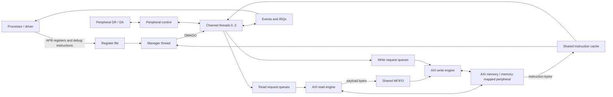
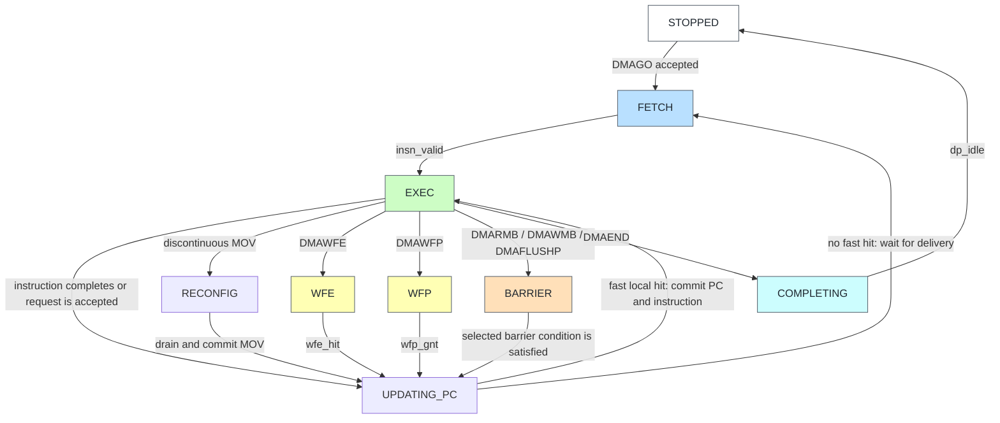
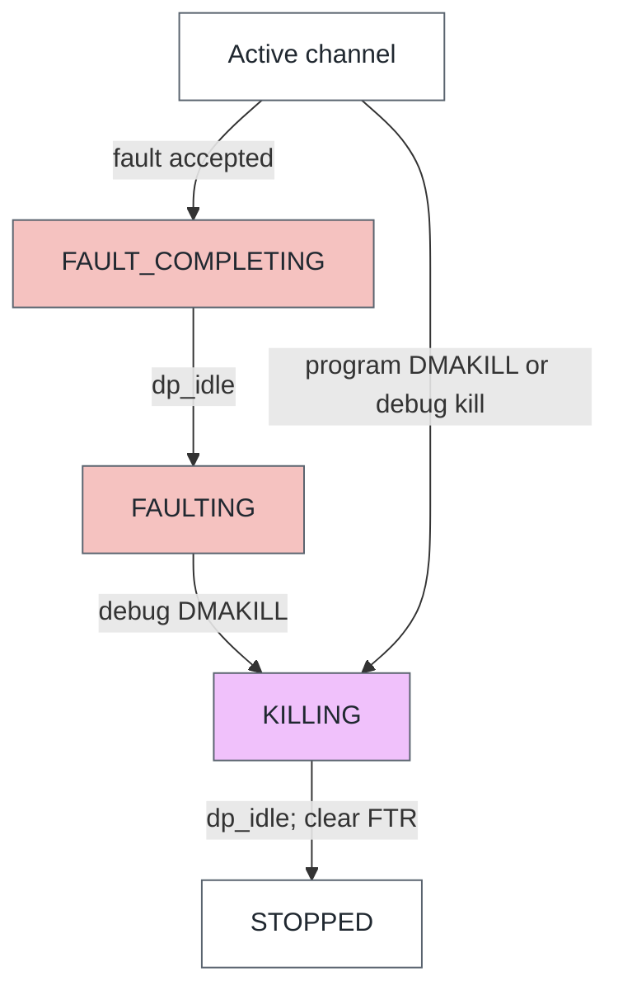

# 1. Background and prerequisites

[Guide index](README.md) · [Next: launch a channel →](01_launch.md)

Read this chapter before interpreting timing pictures. It introduces the vocabulary needed to distinguish software instructions, queued work, accepted bus transfers and completed DMA jobs. References below use the printed section/page labels of Arm DDI 0424D; a PDF viewer's page number includes the front matter and can differ.

| Foundation | Read |
|---|---|
| Architecture and notation | [DMA overview](#11-what-a-dma-controller-does) · [Bits and bytes](#12-bits-bytes-addresses-and-encodings) |
| Interfaces and transfer shape | [APB](#13-apb-the-processors-control-path) · [AXI](#14-axi-five-independently-handshaken-channels) · [Byte lanes](#15-beat-size-byte-lanes-and-unaligned-data) |
| Programming and execution | [Registers and CCR](#16-the-channels-architectural-registers-and-ccr) · [Instructions](#17-instructions-conditions-and-program-structure) · [Thread state](#18-the-difference-between-thread-state-and-datapath-state) |
| Shared storage and synchronization | [MFIFO](#19-mfifo-allocation-reservation-and-load-lock) · [Events and peripherals](#110-events-interrupts-and-peripheral-flow-control) |
| Control and integration | [Faults](#111-faults-and-recovery) · [Instruction cache](#112-instruction-cache-data-visibility-and-cancellation) · [Security, CDC and low power](#113-security-clocks-reset-and-low-power) |
| Reading checklist | [Distinctions to remember](#114-what-to-keep-separate-while-reading) |

## 1.1 What a DMA controller does

A processor could copy memory by repeatedly loading a word and storing it. A DMA controller performs the data movement while the processor does other work. The processor still chooses the addresses, permissions, transfer shape and completion mechanism, and must make program/data memory visible to the DMA.

This DMA is programmable. It executes small instruction streams stored in system memory. A **manager thread** launches **channel threads** using `DMAGO`; each channel has its own program counter, source address, destination address, control register and two loop counters. Channel programs issue load/store instructions into a shared datapath. Data can flow memory-to-memory, memory-to-peripheral, peripheral-to-memory or through zero stores. Peripheral traffic here still uses memory-mapped AXI reads/writes; the DR/DA interface paces transfers and acknowledges them. It does not carry the payload.

A channel is not a separate AXI master port. All channels share one bus interface, instruction cache and dynamically allocated MFIFO. A thread stalled on an event can coexist with other threads moving data. The manager is a control thread, not a fifth copy engine. See TRM §§2.1-2.3 and Chapter 4.

This conceptual diagram does not specify cycle latency. Concrete modules are in [rtl/core](../../../rtl/core) and [rtl/top/axi_dma330.sv](../../../rtl/top/axi_dma330.sv).

## 1.2 Bits, bytes, addresses and encodings

One byte is eight bits. A 64-bit AXI data bus carries eight physical byte lanes. Lane `i` occupies bits `[8*i+7:8*i]`, so lane 0 is the **rightmost** byte of a conventional hexadecimal data word. For example, `0x0706050403020100` has low-lane-first bytes `00 01 02 03 04 05 06 07`. Address order and printed hex-character order must not be confused.

Addresses count bytes. For an incrementing transfer, a beat size of `2^SIZE` bytes describes the address alignment/advance. `SIZE=0,1,2,3` means 1,2,4,8 bytes. `LEN` stores **beats minus one**: `LEN=0` is a one-beat burst; `LEN=15` is a sixteen-beat burst. The same minus-one convention applies to the CCR burst-length fields. The assembler takes a natural beat count and encodes the minus-one field for you.

Instruction bytes are little-endian in memory. `DMAMOV` is six bytes: opcode, destination-register selector, then a 32-bit immediate in least-significant-byte-first order. A program's PC advances by instruction length, not by a fixed word size. Instructions here are one, two, three or six bytes long. A six-byte instruction can straddle a cache-line boundary and require two line fetches.

`0x10000000` is the default source base for channel 0 in the teaching environment, `0x20000000` the destination base, `0x00010000` its program base, and `0x40000000` peripheral FIFO 0. These are **testbench memory-map choices**, not fixed addresses required by DMA330.

## 1.3 APB: the processor's control path

APB performs one register access at a time. A transfer has a setup phase (`PSEL=1`, `PENABLE=0`) followed by an access phase (`PSEL=1`, `PENABLE=1`). It completes at a rising `PCLK` edge with `PREADY=1`. `PWRITE` distinguishes write/read; `PADDR` selects the register. `PWDATA` carries write data and `PRDATA` carries read data. Address/control remain stable while the access waits. A slave error is reported by `PSLVERR` when enabled in this workspace.

Two APB ports provide secure and non-secure views. The ports do not themselves move copy payload. APB writes to `DBGINST0`, `DBGINST1`, then `DBGCMD` cause the DMA to execute a debug instruction. The driver polls `DBGSTATUS` to avoid overwriting a busy request. Asynchronous APB bridging can add wait states, so count access completion on PCLK rather than inferring it from an ACLK column.

Important offsets: `INTEN=0x020`, raw event/interrupt status `0x024`, masked interrupt status `0x028`, `INTCLR=0x02c`, `DBGSTATUS=0xd00`, `DBGCMD=0xd04`, `DBGINST0=0xd08`, `DBGINST1=0xd0c`. Channel status/PC are in the `0x100+8*n` area; channel working registers are in the `0x400+0x20*n` area. Read exact fields in TRM Chapter 3 and the unchanged register model/RTL.

## 1.4 AXI: five independently handshaken channels

| Channel | Direction relative to DMA | Carries | Acceptance condition |
|---|---|---|---|
| AR | Output request | Read address, ID, length, size, attributes | ARVALID and ARREADY |
| R | Input response | Read data, RID, RRESP, RLAST | RVALID and RREADY |
| AW | Output request | Write address, ID, length, size, attributes | AWVALID and AWREADY |
| W | Output payload | WDATA, WSTRB, WLAST | WVALID and WREADY |
| B | Input response | BID and BRESP | BVALID and BREADY |

VALID says the sender is presenting a transfer. READY says the receiver can accept it. The transfer happens only when both are high at the sampling edge. The sender must hold VALID and its payload stable during back-pressure. A high VALID across three cycles can mean three accepted beats if READY is high throughout; a low READY can mean no accepted beats despite continuous VALID.

AR acceptance is not read completion. AW acceptance is not write completion. WLAST marks the final **write data** beat; B is the transaction's write response. Likewise, RLAST completes that read burst only on an accepted final R beat. Never use WLAST alone to declare that a DMA completion interrupt is safe.

An **outstanding** request has been accepted but has not fully returned its response. IDs allow multiple streams and response ordering per ID. Different IDs can complete in a different order. The workspace uses IDs `0..3` for channel data and `f` for all instruction-cache fetches. AXI4 has no WID: complete write-data bursts are sent in the appropriate global order rather than interleaving beats from different channel bursts.

AW and W are independent. This write engine can finish W before a stalled AW is accepted. It must then keep the pending AW stable and preserve its association with that payload. The original write-engine unit test exercises this explicitly. An external checker that universally requires AW acceptance before W would incorrectly reject this valid sequence.

The response encodings are 0=OKAY, 1=EXOKAY, 2=SLVERR and 3=DECERR. This DMA does not request exclusive accesses, so the frozen implementation treats EXOKAY as a bus error too. A top-level trace can contain intentionally injected error responses while the verification test itself passes.

## 1.5 Beat size, byte lanes and unaligned data

`WSTRB[i]=1` means lane `i` contains a byte to write. A full aligned 64-bit beat uses `ff`. A two-byte beat can use `03`, `0c`, `30` or `c0` depending on its address. Other data lanes are irrelevant to that transfer, even if their printed bits are nonzero.

For an INCR burst beginning at byte address `A`, let `S=2^SIZE`, `N=LEN+1`, and `o=A mod S`. Its useful payload is `N*S-o` bytes. The first beat starts at `A`; subsequent beats use the aligned beat sequence. Thus a three-beat 8-byte-sized read starting at lane 3 contributes `5+8+8=21` bytes, not 24. The program generator may emit additional byte-tail transfers to hit an exact job length.

FIXED means every beat uses the same address. Use aligned FIXED transfers when following the Arm programming contract; TRM §2.11.1 defines unaligned FIXED as a programming error. This RTL's acceptance of unaligned FIXED is a documented implementation difference, not a portable feature to rely on.

Source and destination beat shapes can differ. Sixteen byte reads and two 64-bit writes both represent sixteen bytes. The MFIFO preserves a per-channel byte stream while the datapath extracts incoming lanes and positions outgoing lanes. Packing and unpacking therefore change the beat count while preserving payload bytes and ordering.

## 1.6 The channel's architectural registers and CCR

| Register | Meaning | Typical writer |
|---|---|---|
| CPC | Current program address; faulting instruction address for a precise abort | Thread control |
| SAR | Source byte address | DMAMOV, DMALD/DMALDP, DMAADDH/DMAADNH |
| DAR | Destination byte address | DMAMOV, DMAST/DMASTP/DMASTZ, address arithmetic |
| CCR | Source/destination size, count, increment, attributes, endian group | DMAMOV CCR |
| LC0, LC1 | Finite-loop state | DMALP and DMALPEND |
| CSR | Architectural state and wait information | Hardware |
| FTR | Fault-type bitmap | Abort logic; cleared by channel lifecycle/restart |
| FAR | First failing bus address in this workspace | Workspace extension |

CCR layout is identical to the packed structure in [dma330_pkg.sv](../../../rtl/core/dma330_pkg.sv):

| Bits | Field | Interpretation |
|---|---|---|
| 0 | src_inc | 0 FIXED, 1 INCR |
| 3:1 | src_burst_size | log2(bytes per read beat) |
| 7:4 | src_burst_len | read beats minus one |
| 10:8 / 13:11 | src_prot / src_cache | Read security/privilege/instruction and cache attributes |
| 14 | dst_inc | 0 FIXED, 1 INCR |
| 17:15 | dst_burst_size | log2(bytes per write beat) |
| 21:18 | dst_burst_len | write beats minus one |
| 24:22 / 27:25 | dst_prot / dst_cache | Write protection and cache attributes |
| 30:28 | endian_swap | 0 none; 1/2/3/4 reverse bytes in 2/4/8/16-byte groups |
| 31 | Reserved | Do not use |

PROT[1]=1 requests a non-secure bus access. A non-secure thread cannot use CCR to request secure data accesses. Cache attributes describe external memory behavior; they are separate from the DMA's own instruction-cache tags.

SAR/DAR usually advance when the thread successfully submits the descriptor, ahead of AXI completion. They track program progress, not a count of bytes already committed to memory. For FIXED transfers the corresponding address remains constant. Use B/R handshakes and barriers to establish completion.

## 1.7 Instructions, conditions and program structure

| Family | Main effect |
|---|---|
| DMAMOV / DMAADDH / DMAADNH | Set a working register or add an unsigned/negative halfword to an address |
| DMALD / DMALDP | Queue a read into the channel's byte stream; LDP also requests a peripheral acknowledgement |
| DMAST / DMASTP | Queue writes from loaded channel bytes; STP also requests an acknowledgement |
| DMASTZ | Queue zero-valued writes without loaded payload |
| DMALP / DMALPEND | Finite loops using LC0/LC1 |
| DMALPFE | Assembler form of a non-finite loop end; request_last can terminate it |
| DMARMB / DMAWMB | Wait for this channel's relevant read/write work to complete |
| DMAWFP / DMAFLUSHP | Wait for a peripheral request / synchronize its request state |
| DMAWFE / DMASEV | Wait for / send an event or interrupt |
| DMAEND / DMAKILL | Normal termination / cancellation with cleanup |
| DMAGO | Manager-only channel launch |

The S/B suffix is a **condition**, not a separate physical bus. It compares the channel's request_type flag, established by DMAWFP. A non-matching conditional instruction acts as a NOP. A matching S load/store transfers one beat and ignores the CCR length; a matching B form uses the CCR burst length. Seeing an S or B opcode in a trace does not by itself prove a transaction was issued: check descriptor VALID/READY and bus acceptance.

`DMALP iterations` encodes iterations minus one. PC jumps backwards at DMALPEND while the loop remains active. Two counters allow nested loops; they do not automatically describe rows or strides. A 2D operation is software made from loops and address-add instructions. TRM Chapter 4 specifies the instruction encodings; the [unchanged assembler](../../../tb/env/dma330_asm.sv) makes the exact program bytes visible in simulation logs.

## 1.8 The difference between thread state and datapath state

The channel state describes what its **instruction thread** is doing. It does not describe every read, write or byte in the datapath. A channel can issue a load, fetch and execute later instructions, and reach a write barrier while earlier bus transfers remain outstanding. Read/write queues decouple program execution from bus timing.

The descriptions below follow the frozen [channel RTL](../../../rtl/core/dma_channel.sv), its [status encodings](../../../rtl/core/dma330_pkg.sv), and Arm DDI 0424D §2.3. They describe a **channel**, not the separate manager FSM. Workspace-specific transitions and integration details are identified explicitly.

### 1.8.1 Internal state, waveform label and software-visible CSR

There are two different encodings. The current revision adds UPC and CFG phases and reports true shared-cache refill status separately from local fetch work. `state` is the implementation enum used in the pictures; `CSRn[3:0]` is the status read by software. The numbers are not interchangeable. For example, internal `WFE=3` is reported as architectural `Waiting for event=4`.

| Internal enum | Decimal value | WaveDrom label | CSRn[3:0] | Meaning |
|---|---:|---|---|---|
| `C_STOPPED` | 0 | `STOP` | `0x0` | No channel program is executing. |
| `C_FETCH` | 1 | `FET` | `0x1` or `0x2` | Obtain the instruction; report Cache miss only for this thread's active shared-cache refill (`ic_refill`). |
| `C_EXEC` | 2 | `EX` | `0x1` | Decode/execute the current instruction, or wait for its request to be accepted. |
| `C_WFE` | 3 | `WFE` | `0x4` | Wait for the selected event. |
| `C_WFP` | 4 | `WFP` | `0x7` | Wait for a qualifying peripheral request. |
| `C_BARRIER` | 5 | `BAR` | `0x5` | Wait for the selected transfer direction, or submit a peripheral flush after draining both directions. |
| `C_COMPLETING` | 6 | `END` | `0x9` | Normal program end: wait for channel data work to finish. |
| `C_KILLING` | 7 | `KILL` | `0x8` | Cancel the program, flush queued work and retire outstanding bus obligations. |
| `C_FAULT_COMPLETING` | 8 | `FC` | `0xe` | An abort is recorded; clean up while outstanding data work retires. |
| `C_FAULTING` | 9 | `FLT` | `0xf` | Fault is latched; await a debug DMAKILL. |
| `C_UPDATING_PC` | 10 | `UPC` | `0x3` | Calculate and commit sequential/loop PC; overlap fetch of the target. |
| `C_RECONFIG` | 11 | `CFG` | `0x5` | Drain a discontinuity barrier before committing DMAMOV. |

CSR `0x3` is now explicitly implemented. Ordinary accepted instructions and wait/barrier wakeups pass through UPC before selecting direct EXEC or FETCH. Internal enum 10 is therefore architectural status 3; internal WFE remains enum 3 and architectural status 4. The figures show the internal phase and architectural CSR status as separate rows.

In this CSR layout, `[8:4]` identifies the wakeup event/peripheral while waiting, `[15]` and `[14]` identify the P/B DMAWFP selection while in WFP, and `[21]` reports the channel's non-secure state. A retained wakeup number outside WFE/WFP does not mean the channel is still waiting. Decode the low status field first, then interpret the associated context bits.

State colors add a visual cue: fetching is blue, execution green, waits amber, barriers peach, normal completion cyan, killing lavender and faults rose. The label and the table above remain the meaning of the state.

### 1.8.2 Normal execution and wait transitions

An arrow represents a clocked transition when its condition is sampled. If the condition is absent, the current state remains. The diagram omits self-loops and fault/kill overrides to keep normal execution readable; those overrides are described below. No arrow implies a fixed architectural latency.

### 1.8.3 Starting, fetching and executing

**STOPPED — a program can be launched.** Reset enters this state. Normal completion or a completed kill also returns here. `fetch_req=0`, so the channel is not requesting a new instruction. The channel asserts `dp_flush` to discard residual queued/MFIFO context; this does not mean that every other channel or the shared instruction cache is idle.

On `go_valid` while stopped, the channel loads `go_pc` into PC, captures `go_ns`, clears its request flags and FTR/FAR bookkeeping, and enters FETCH. It also requests thread-local instruction-cache invalidation. This launch does **not** reset SAR, DAR, CCR or loop counters; the program must initialize the registers it needs. A DMAGO addressed to an already running channel does not restart it. A displayed CPC value while stopped is retained register context, not proof that an instruction at that address is executing.

**FETCH — obtain a complete instruction.** The channel asserts `fetch_req` for its current PC. Its fetch unit may satisfy the request from a local line buffer or request a shared-cache response, including the next line for a crossing instruction. `insn_valid` permits FETCH → EXEC. Until a usable instruction arrives, PC remains unchanged and the channel stays in FETCH. A canceled/retried refill is not a delivered instruction; see the [cache cancellation operation](14_cache.md).

Within FETCH, software sees Cache miss only when the shared cache reports `ic_refill=1` for this thread, from its refill AR phase through RLAST, including stalls. Arbitration wait, instruction assembly and a warm shared-cache hit report Executing. The front-end `fetch_miss` describes local-buffer work and no longer selects CSR status. An invalidated refill may drain without reporting an active miss. A `fetch_err` records an instruction-fetch fault and FAR=PC, then enters FAULT_COMPLETING rather than executing the returned bytes.

**EXEC — act on the decoded instruction.** Simple operations such as DMAMOV, DMANOP, address arithmetic and DMASEV update their effects and proceed through UPC to direct EXEC on a fast local hit, otherwise FETCH. Loop instructions also proceed through UPC to direct EXEC on a fast local hit, otherwise FETCH, choosing either the sequential PC or a branch target. For loads and stores, leaving EXEC normally means the descriptor was accepted by the datapath, not that AXI data has finished moving.

| Instruction class in EXEC | Condition to leave EXEC | PC/address effect |
|---|---|---|
| DMALD / DMALDP, with a true execution condition | `ld_ready=1` | Select UPC to advance PC; increment SAR by the descriptor's useful byte count if source incrementing is enabled. |
| DMAST / DMASTP / DMASTZ, with a true execution condition | `st_ready=1` | Select UPC to advance PC; increment DAR by the descriptor's useful byte count if destination incrementing is enabled. |
| Conditional load/store whose condition is false | No request is issued | Select UPC for the skipped instruction; do not increment SAR/DAR for a transfer. |
| DMAWFE / DMAWFP / barrier | Enter the corresponding wait state | Keep PC at this instruction until its wait completes. |
| DMAEND / DMAKILL | Enter COMPLETING / KILLING | Do not fetch the following instruction. |
| Invalid instruction, invalid operand or other execute-time fault | Enter FAULT_COMPLETING | The normal instruction effect is suppressed. |

If a required `ld_ready` or `st_ready` is low, the channel stays in EXEC with the same instruction/PC. Queue capacity, MFIFO admission or contention can therefore extend EX without producing WFE, WFP or BAR. Other channel and AXI activity can continue during this stall.

### 1.8.4 Waiting for an event, a peripheral or a barrier

**WFE — wait for an event.** DMAWFE captures the event number in `wake_num` and enters WFE. The channel asserts `wfe_valid` for that event. On `wfe_hit`, it enters UPC, which commits PC past DMAWFE before direct EXEC or FETCH. A sticky event set before the wait can satisfy it; the producer need not pulse DMASEV during the displayed WFE interval. An interrupt-routed event (`INTEN[e]=1`) does not satisfy WFE in this design.

WFE suspends instruction progress, not previously submitted bus work, and it releases the load-lock. If the DMAWFE invalidation option is set, the cache-maintenance request is made when that instruction executes, before waiting for the event. See [late and sticky events](13_events.md).

**WFP — wait for peripheral permission.** DMAWFP records the peripheral number and S/B/P selection, then asserts `wfp_valid` while waiting. The release condition is the core-side `wfp_gnt` from peripheral control. On a grant, the channel records request-type/last context, selects UPC to advance PC before direct EXEC or FETCH. S and B select single/burst request flags with `req_last=0`; P copies burst/last information from the granted peripheral context. The detailed qualification rules are illustrated in [request types](12_request_types.md).

External DR acceptance and internal WFP grant are different events, especially across CDC. A request can already be pending before WFP begins. Leaving WFP permits subsequent instructions to transfer data; it does not establish that payload was read/written or that a DA acknowledgement has reached the peripheral. See [memory-to-peripheral](10_m2p.md), [peripheral-to-memory](11_p2m.md) and [CDC](19_cdc.md).

**BARRIER — apply the instruction's ordering condition.** There is one internal state for three operations, distinguished by `barrier_wr` and `barrier_fl`:

| Instruction | Condition used by this RTL | What happens on release |
|---|---|---|
| DMARMB | `rd_busy=0` | Select UPC to advance PC before direct EXEC or FETCH; writes need not also be idle. |
| DMAWMB | `wr_busy=0` | Select UPC to advance PC before direct EXEC or FETCH; reads need not also be idle. |
| DMAFLUSHP | First require `dp_idle`; then require `flush_valid && flush_ready` | Clear request-type/last flags, advance PC and proceed through UPC to direct EXEC on a fast local hit, otherwise FETCH. |

For DMAFLUSHP, `flush_ready` means peripheral control has accepted the flush request into its acknowledgement queue. It does **not** mean that the external DA flush request and returning DR flush acknowledgement have already completed. Peripheral control manages that exchange separately. See [peripheral transfers](10_m2p.md).

PC remains on the barrier instruction until its release condition is met, and the load-lock is released. Discontinuous DMAMOV now uses a separate RECONFIG phase reporting At barrier; see [implementation boundaries](99_validation.md#implementation-boundaries).

### 1.8.5 Completing, killing and handling a fault

These states all stop normal instruction execution, but the reason, cleanup policy and destination state differ:

| State | Entry | While resident | Exit |
|---|---|---|---|
| COMPLETING | Execute DMAEND | Allow queued/in-flight data work to finish normally; `dp_flush` is not asserted by this state. | `dp_idle=1` → STOPPED; thread-local cache maintenance is requested at completion. |
| KILLING | Execute DMAKILL, or receive `dbg_kill` while not stopped | Assert `dp_flush`; discard queued work/returning read payload as applicable, while the bus engines retire obligations that cannot be canceled. | `dp_idle=1` → STOPPED; clear FTR and request thread-local cache maintenance. |
| FAULT_COMPLETING | Fetch/execute fault, eligible data-bus error, debug fault or aborting watchdog indication | Latch fault information, assert `dp_flush`, and retire outstanding data work without continuing the program. | `dp_idle=1` → FAULTING; fault information remains latched. |
| FAULTING | Fault cleanup has reached `dp_idle` | Keep the channel halted with `dp_flush=1`; the channel's `faulting` indication remains asserted. | Debug DMAKILL → KILLING → STOPPED. |

The second diagram summarizes the ordinary abort/recovery path; exact event eligibility and priority are described below. `faulting` is asserted in **both** FC and FLT. FC can remain visible for a long time when the bus does not retire outstanding work; FLT is the halted fault state after that cleanup condition is satisfied. DMAGO alone cannot recover a faulted channel because launch is accepted only in STOPPED.

The waveform label `END` means COMPLETING, not “already stopped” and not “IRQ asserted.” DMAEND does not itself execute DMASEV. For an ordered completion notification, the illustrated program uses `DMAWMB; DMASEV; DMAEND`: the barrier waits for writes, DMASEV signals the configured event/IRQ, and DMAEND terminates the thread. See [copy and completion](02_copy.md).

Kill is cancellation, not rollback. An AXI transfer already accepted by the interconnect must still obey the bus protocol; destination bytes already written remain changed. The read/write tracking queues are not flushed as if those transactions never existed. FAR can retain diagnostic context after kill; a subsequent accepted DMAGO clears its bookkeeping. See [kill](15_kill.md) and [precise/imprecise faults](16_faults.md).

For recovery, read CSR/CPC/FTR/FAR before issuing debug DMAKILL, wait until CSR reports Stopped, repair the cause and relaunch a correctly initialized program. KILLING clears FTR only when its idle condition is satisfied. Neither kill nor a watchdog report guarantees a bounded stop time if an external slave never retires a required response.

### 1.8.6 What the busy and idle conditions actually mean

For the selected channel, the channel RTL defines `dp_idle = !rd_busy && !wr_busy`. These busy signals are per channel, even though the engines and MFIFO are shared.

| Signal | What keeps it asserted in the frozen implementation |
|---|---|
| `rd_busy` | A read descriptor is queued, or the read tracking queue still contains an outstanding transfer. Peripheral-acknowledgement handling can also delay retirement. |
| `wr_busy` | A store is queued/active, or the write-response tracking queue is not empty. Completing WLAST alone is insufficient while a B response remains outstanding. |
| `dp_idle` | Both of the above are clear; this does not directly test that MFIFO occupancy is zero, that instruction refills are idle, or that every peripheral acknowledgement has reached its external pin. |

Thus a channel may wait in WFE/WFP while `rd_busy` or `wr_busy` is still high. Conversely, it can be in EXEC with both low while doing register arithmetic. `COMPLETING → STOPPED` waits for channel data work, not every other channel. Residual MFIFO bytes are cleaned through the channel's flush path; a nonzero occupancy by itself is not an extra explicit test in the completion-state transition.

Instruction-refill cancellation is handled separately by the fetch/cache protocol. A data-path `dp_idle` decision must not be read as proof that every shared-cache response has vanished. Whole-core sleep has additional quiescence checks; see [low power](20_lowpower.md).

### 1.8.7 Fault/kill overrides and PC interpretation

The clocked FSM first evaluates its normal state action and then applies override conditions. For competing **state assignments** on the same edge, later applicable assignments in this RTL win:

| Increasing state-assignment priority | Applicable behavior |
|---|---|
| Normal state logic | Fetch, instruction acceptance, wakeup, barrier or completion transition; execute/fetch faults are handled here too. |
| Data-read/write error | While not STOPPED/KILLING, record error bits; enter FAULT_COMPLETING unless already in a fault state. |
| Debug instruction/event/operand fault | Record the corresponding FTR bits and debug-instruction bit; enter FAULT_COMPLETING unless already in a fault state. |
| Aborting watchdog indication | In FETCH, EXEC, UPC, WFE, WFP, BARRIER, RECONFIG or COMPLETING, record lockup and enter FAULT_COMPLETING. |
| Debug kill | For any state other than STOPPED, select KILLING. |

Reset initializes STOPPED independently of this sequence. The priority table concerns the selected next state; it does not imply that every earlier register assignment or already accepted datapath action is undone. Fault bits can still be latched when a same-edge debug kill wins the state selection.

WFE/WFP are legitimate unbounded waits. The core's watchdog normally excludes them when no channel data work remains; outstanding queued/in-flight work can keep watchdog monitoring active. KILLING and existing fault states do not take a fresh watchdog abort transition through `wd_can_fault`, although the watchdog can retain/report diagnostic information. These are workspace watchdog details, not additional Arm channel states.

During FETCH/EXEC, PC identifies the instruction being fetched/executed; during WFE/WFP/BARRIER it stays on the instruction whose condition has not completed. A released wait enters UPC; PC commits at the end of that phase. During END/KILL/fault handling, it is retained context rather than a stream of new instruction executions. Precise aborts identify the offending instruction; an imprecise data-bus error can arrive after PC has advanced past the initiating load/store. Inspect FTR/FAR and the accepted bus transactions instead of assuming that a bus error belongs to the instruction currently displayed at CPC. TRM §2.8 explains precise versus imprecise aborts.

### 1.8.8 Following a state sequence in a waveform

| Example | State sequence to recognize | Main observation |
|---|---|---|
| [Launch and ordinary copy](01_launch.md) | STOP → FET → EX, with repeated FET/EX pairs | Accepted DMAGO starts fetching; a descriptor can leave EX before its AXI response returns. |
| [Wait for an event](13_events.md) | EX → WFE → FET | Find `wfe_hit` and the sticky event context; other data work may continue while PC is held. |
| [Peripheral-paced transfer](10_m2p.md) | EX → WFP → FET | Find core-side grant separately from external DR/DA handshakes and payload movement. |
| [Write completion](02_copy.md) | EX → BAR → FET → EX; eventually END → STOP | The write barrier releases after write retirement; notification and thread termination are separate instructions. |
| [Cancellation](15_kill.md) | WFE → KILL → STOP | A debug kill overrides the wait without consuming the awaited event. |
| [Abort](16_faults.md) | EX or another eligible active state → FC → FLT | FC drains/cleans up; FLT remains latched until software requests debug kill. |

Each visible cell is a pre-edge snapshot. A grant, final response or error sampled at its right boundary causes a state update that is visible in the following cell. Idle compression can omit repeated state cells, so use the source-cycle row and milestone times rather than inferring elapsed cycles from adjacent labels alone. The [waveform conventions](00_conventions.md) define the sampling rule in full.

### 1.8.9 Updating PC, real refills and implicit reconfiguration barriers

**UPDATING_PC is an architectural phase with observable work.** The optimized channel enters EXEC directly at the end of UPC when `fetch_fast_hit=1`. This requires the front end to be idle, the complete target instruction to fit inside the valid local line buffer, and no pending result, error or invalidation. The same edge registers the instruction and commits PC. Otherwise UPC selects FETCH and waits for delivery. This bypass adds no architectural status: CSR is still 3 during UPC and 1 in EXEC; FETCH reports 1 or 2 according to actual refill state. Instruction effects occur in EXEC. Sequential and loop-branch arithmetic commit registered CPC at the end of UPC. The fetch unit is enabled during UPC using `fetch_pc`, the calculated target, so fetching overlaps calculation rather than adding a mandatory idle fetch bubble. There is no second issue of LD/ST in UPC. END and KILL retain the terminating PC. Event/peripheral/barrier releases select UPC instead of directly committing the next PC.

In a snapshot, CPC can still show the old instruction during UPC while `fetch_pc` already presents the next target. A taken loop chooses the backward target; loop exit chooses the sequential target. Software polling can now observe CSR=3. This extra status must not be mistaken for a cache miss or a stalled bus descriptor.

**Cache miss is a per-thread shared-cache condition.** A cold local buffer can hit a warm shared-cache line without external AR and without CSR=2. Conversely, a real refill holds pending across ARREADY and R stalls. A cache hit from another thread can be serviced under that miss; a refill does not serialize all thread hits. The cache response port still needs arbitration at RLAST. Inspect thread ID, NS tag and refill-pending context, not only instruction-side VALID.

**RECONFIG defers a discontinuous DMAMOV.** The MOV's immediate is decoded but the destination register is not changed until its ordering requirement is satisfied. A source discontinuity waits for reads; a destination discontinuity waits for both reads and writes and discards the old destination-formatted residual bytes. The MOV then commits and execution proceeds through UPC. CSR reports At barrier throughout CFG. The exact discontinuity decision depends on the changed CCR/address fields; changing burst length alone or incrementing destination beat size preserves residual data where the TRM permits it.

A destination retarget is therefore not a way to send arbitrarily accumulated residual bytes to a new address. Configure both sides before LD for ordinary copies. When deliberately changing formats mid-program, distinguish bytes already committed on AXI from MFIFO residual bytes that the specification discards.

**Related current-revision behavior:** a false conditional store preserves the load-lock; a non-secure DMAMOV CCR checks both immediate protection fields before committing the new CCR; 128-bit endian groups can be buffered across narrower bus beats. AW issue can run ahead of W through committed write contexts. Kill must retain data for all committed contexts, including those queued behind another channel. These mechanisms explain why descriptor acceptance, address issue, WLAST and B retirement are separate milestones.

## 1.9 MFIFO allocation, reservation and load-lock

The MFIFO is a shared pool of eight-byte lines in this build, with a byte stream per channel. A channel may use more than one quarter of the 1024-byte pool; there are no fixed 256-byte partitions. Read admission reserves space for future response data before it issues a request. A returning read beat can therefore be accepted without competing for storage that was promised to another channel.

Distinguish payload bytes already present, lines owned/partially occupied, lines reserved for reads in flight and the total physical capacity. `DP.used` in the figures counts the implementation's reserved/owned **lines**, not bytes and not solely bytes already returned on R.

Arm's load-lock permits a channel to retain ownership across consecutive loads. It releases the lock at a store, barrier, wait, normal termination or abort. This keeps a well-budgeted program from being stranded halfway through its load sequence by another channel. It is a resource scheduling rule, not an AXI LOCK/exclusive transaction.

TRM §2.11.4 defines a program's static and dynamic line requirements. The combined requirement is the sum of static requirements plus the largest dynamic requirement. That total must fit the MFIFO. A channel waiting while holding bytes contributes to the static requirement. Avoid programs that accumulate data and then wait for each other with no space left. This RTL also has all-running-channel load-blocked deadlock detection and a programmable watchdog; those mechanisms must not be mistaken for proof that any program is safe to schedule.

## 1.10 Events, interrupts and peripheral flow control

Each event number has one sticky flag. DMASEV sets it. With INTEN[e]=0 the number is an event: DMAWFE can consume the flag and release all threads currently waiting for it. With INTEN[e]=1 it is an interrupt: the flag drives IRQ[e] and software clears it through INTCLR. An interrupt-routed number does not satisfy DMAWFE in this design.

DMASEV does not inherently wait for outstanding data writes. Use `DMAWMB; DMASEV` if an observer must see the destination data before seeing completion. For CPU visibility, the system's caches/interconnect ordering and any needed CPU barriers/cache maintenance also matter; the waveform proves the DMA-side order, not coherency in an arbitrary SoC.

The peripheral interface has two independent VALID/READY paths. DR carries requests to the DMA, with types single=0, burst=1 and flush acknowledgement=2. DA carries acknowledgements to the peripheral, with single=0, burst=1 and flush request=2. DRLAST marks the final request in a peripheral-controlled series. The request fields must remain stable under back-pressure. DMAWFP determines how request flags are established; DMALDP/DMASTP determine when transfer completion is acknowledged. See TRM §2.6 before using the peripheral timing examples.

## 1.11 Faults and recovery

An abort has a source, a faulting thread, a recorded PC and a fault bitmap. An invalid opcode differs from an invalid operand; a data-read error differs from an instruction-fetch error even though both use AXI R. `irq_abort` reports faults independently of ordinary completion events.

A **precise abort** identifies the offending instruction in CPC/DPC. An **imprecise abort** can be reported after the thread has advanced, so its recorded PC need not identify the load/store that caused the problem. In particular, TRM §2.8 and Table 3-16 classify data-read/data-write bus errors and lock-up as imprecise; instruction-fetch errors and invalid instructions are precise. Table 3-16 marks st_data_unavailable as precise, which the small store-without-data case explicitly checks. Do not use a later B error's current CPC as the original store address.

Already submitted data work may still drain during abort handling. The thread can pass through Fault completing before Faulting. Diagnose FTR/FTRD, the applicable PC information and the workspace's FAR before issuing DMAKILL to clear/stop the context. Repair the program/data/security setting before launching again. See TRM §§2.7-2.9, §3.3 fault/status registers and Chapter 4 instruction restrictions.

## 1.12 Instruction cache, data visibility and cancellation

Instruction memory and data memory use the same external AXI bus but have different roles. The shared cache refills a 32-byte line here. Each thread also has a fetch-unit line buffer. PC or program context changes can invalidate these resources. A line is tagged by thread identity and NS state in this implementation; two threads at the same address need not share executable contents.

Invalidation can occur while an AXI refill is pending. The DMA still has to drain that accepted read. Its returned data must not become a valid instruction for a killed/restarted thread. The cache/fetch protocol uses retry/cancellation so the fetch restarts from the correct PC. A stale data value on an invalid instruction bus is not a delivered instruction.

The processor must place the program in memory and perform the appropriate system cache maintenance before DMAGO. Modifying a running program requires synchronization; the Arm `DMAWFE ..., invalid` mechanism is illustrated later. This guide's memory VIP is not a CPU cache-coherency model.

## 1.13 Security, clocks, reset and low power

The manager and each channel have secure/non-secure execution state. DMAGO's NS bit selects a new channel's state, subject to manager permissions. CR3 and CR4 select which events and peripherals are non-secure. A non-secure channel may not access a secure event/peripheral and may not request secure AXI data attributes. Separate APB views restrict what a non-secure caller can observe/control. A secure launch of an NS channel is a valid and useful sequence.

CDC means signals cross unrelated clock domains. A synchronizer reduces metastability risk for control; a handshake bridge preserves a multi-bit request/response. A delay across a CDC boundary is not a fixed number of nanoseconds and can depend on relative clock phase. Sample each external protocol on its own clock. Core-side WFP grant is later than external DR acceptance when synchronizers intervene.

System reset abandons active controller state and resets the connected verification endpoints. It need not undo writes already performed. Interface-only resets require the bridge's reset recovery protocol; inspect the original corner/reset tests. Waveform simulation does not establish analog metastability performance or replace structural CDC analysis.

Q-Channel is a workspace extension. An external controller lowers QREQn to ask for quiescence; the DMA accepts with QACCEPTn=0 or denies with QDENY=1. Only after acceptance can the DUT clock be gated. QACTIVE signals work or an incoming APB request so the external controller can restore the clock. A waveform showing a free-running `aclk` and a flat `dut_aclk` is expected while the DUT branch sleeps.

## 1.14 What to keep separate while reading

Always distinguish a job's requested byte count, the instruction descriptor's byte count, bus beat count, accepted beats and completed responses. Keep the internal FSM distinct from CSR encodings, source-data reads distinct from instruction refills, peripheral completion distinct from job completion, and test PASS distinct from the absence of intentional DUT faults. These distinctions explain most initially surprising waveform sequences.

---

[← Guide index](README.md) · [Next: launch a channel →](01_launch.md)
