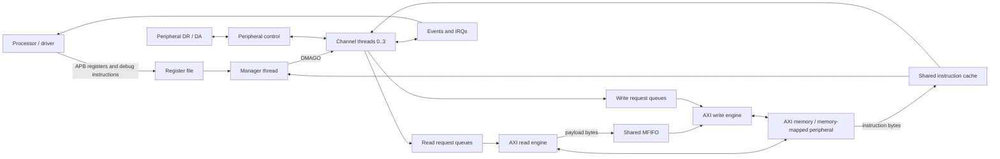

# 1. Background and prerequisites

[Guide index](README.md) · [Next: launch a channel →](01_launch.md)

Read this chapter before interpreting timing pictures. It introduces the vocabulary needed to distinguish software instructions, queued work, accepted bus transfers and completed DMA jobs. References below use the printed section/page labels of Arm DDI 0424D; a PDF viewer's page number includes the front matter and can differ.

| Foundation | Read |
|---|---|
| Architecture and notation | [DMA overview](#11-what-a-dma-controller-does) · [Bits and bytes](#12-bits-bytes-addresses-and-encodings) |
| Interfaces and transfer shape | [APB](#13-apb-the-processors-control-path) · [AXI](#14-axi-five-independently-handshaken-channels) · [Byte lanes](#15-beat-size-byte-lanes-and-unaligned-data) |
| Programming and execution | [Registers and CCR](#16-the-channels-architectural-registers-and-ccr) · [Instructions](#17-instructions-conditions-and-program-structure) · [Thread state](#18-the-difference-between-thread-state-and-datapath-state) |
| Shared storage and synchronization | [MFIFO](#19-mfifo-allocation-reservation-and-load-lock) · [Events and peripherals](#110-events-interrupts-and-peripheral-flow-control) |
| Control and integration | [Faults](#111-faults-and-recovery) · [Instruction cache](#112-instruction-cache-data-visibility-and-cancellation) · [Security, CDC and low power](#113-security-clocks-reset-and-low-power) |
| Reading checklist | [Distinctions to remember](#114-what-to-keep-separate-while-reading) |

## 1.1 What a DMA controller does

A processor could copy memory by repeatedly loading a word and storing it. A DMA controller performs the data movement while the processor does other work. The processor still chooses the addresses, permissions, transfer shape and completion mechanism, and must make program/data memory visible to the DMA.

This DMA is programmable. It executes small instruction streams stored in system memory. A **manager thread** launches **channel threads** using `DMAGO`; each channel has its own program counter, source address, destination address, control register and two loop counters. Channel programs issue load/store instructions into a shared datapath. Data can flow memory-to-memory, memory-to-peripheral, peripheral-to-memory or through zero stores. Peripheral traffic here still uses memory-mapped AXI reads/writes; the DR/DA interface paces transfers and acknowledges them. It does not carry the payload.

A channel is not a separate AXI master port. All channels share one bus interface, instruction cache and dynamically allocated MFIFO. A thread stalled on an event can coexist with other threads moving data. The manager is a control thread, not a fifth copy engine. See TRM §§2.1-2.3 and Chapter 4.

This conceptual diagram does not specify cycle latency. Concrete modules are in [rtl/core](../../../rtl/core) and [rtl/top/axi_dma330.sv](../../../rtl/top/axi_dma330.sv).

## 1.2 Bits, bytes, addresses and encodings

One byte is eight bits. A 64-bit AXI data bus carries eight physical byte lanes. Lane `i` occupies bits `[8*i+7:8*i]`, so lane 0 is the **rightmost** byte of a conventional hexadecimal data word. For example, `0x0706050403020100` has low-lane-first bytes `00 01 02 03 04 05 06 07`. Address order and printed hex-character order must not be confused.

Addresses count bytes. For an incrementing transfer, a beat size of `2^SIZE` bytes describes the address alignment/advance. `SIZE=0,1,2,3` means 1,2,4,8 bytes. `LEN` stores **beats minus one**: `LEN=0` is a one-beat burst; `LEN=15` is a sixteen-beat burst. The same minus-one convention applies to the CCR burst-length fields. The assembler takes a natural beat count and encodes the minus-one field for you.

Instruction bytes are little-endian in memory. `DMAMOV` is six bytes: opcode, destination-register selector, then a 32-bit immediate in least-significant-byte-first order. A program's PC advances by instruction length, not by a fixed word size. Instructions here are one, two, three or six bytes long. A six-byte instruction can straddle a cache-line boundary and require two line fetches.

`0x10000000` is the default source base for channel 0 in the teaching environment, `0x20000000` the destination base, `0x00010000` its program base, and `0x40000000` peripheral FIFO 0. These are **testbench memory-map choices**, not fixed addresses required by DMA330.

## 1.3 APB: the processor's control path

APB performs one register access at a time. A transfer has a setup phase (`PSEL=1`, `PENABLE=0`) followed by an access phase (`PSEL=1`, `PENABLE=1`). It completes at a rising `PCLK` edge with `PREADY=1`. `PWRITE` distinguishes write/read; `PADDR` selects the register. `PWDATA` carries write data and `PRDATA` carries read data. Address/control remain stable while the access waits. A slave error is reported by `PSLVERR` when enabled in this workspace.

Two APB ports provide secure and non-secure views. The ports do not themselves move copy payload. APB writes to `DBGINST0`, `DBGINST1`, then `DBGCMD` cause the DMA to execute a debug instruction. The driver polls `DBGSTATUS` to avoid overwriting a busy request. Asynchronous APB bridging can add wait states, so count access completion on PCLK rather than inferring it from an ACLK column.

Important offsets: `INTEN=0x020`, raw event/interrupt status `0x024`, masked interrupt status `0x028`, `INTCLR=0x02c`, `DBGSTATUS=0xd00`, `DBGCMD=0xd04`, `DBGINST0=0xd08`, `DBGINST1=0xd0c`. Channel status/PC are in the `0x100+8*n` area; channel working registers are in the `0x400+0x20*n` area. Read exact fields in TRM Chapter 3 and the unchanged register model/RTL.

## 1.4 AXI: five independently handshaken channels

| Channel | Direction relative to DMA | Carries | Acceptance condition |
|---|---|---|---|
| AR | Output request | Read address, ID, length, size, attributes | ARVALID and ARREADY |
| R | Input response | Read data, RID, RRESP, RLAST | RVALID and RREADY |
| AW | Output request | Write address, ID, length, size, attributes | AWVALID and AWREADY |
| W | Output payload | WDATA, WSTRB, WLAST | WVALID and WREADY |
| B | Input response | BID and BRESP | BVALID and BREADY |

VALID says the sender is presenting a transfer. READY says the receiver can accept it. The transfer happens only when both are high at the sampling edge. The sender must hold VALID and its payload stable during back-pressure. A high VALID across three cycles can mean three accepted beats if READY is high throughout; a low READY can mean no accepted beats despite continuous VALID.

AR acceptance is not read completion. AW acceptance is not write completion. WLAST marks the final **write data** beat; B is the transaction's write response. Likewise, RLAST completes that read burst only on an accepted final R beat. Never use WLAST alone to declare that a DMA completion interrupt is safe.

An **outstanding** request has been accepted but has not fully returned its response. IDs allow multiple streams and response ordering per ID. Different IDs can complete in a different order. The workspace uses IDs `0..3` for channel data and `f` for all instruction-cache fetches. AXI4 has no WID: complete write-data bursts are sent in the appropriate global order rather than interleaving beats from different channel bursts.

AW and W are independent. This write engine can finish W before a stalled AW is accepted. It must then keep the pending AW stable and preserve its association with that payload. The original write-engine unit test exercises this explicitly. An external checker that universally requires AW acceptance before W would incorrectly reject this valid sequence.

The response encodings are 0=OKAY, 1=EXOKAY, 2=SLVERR and 3=DECERR. This DMA does not request exclusive accesses, so the frozen implementation treats EXOKAY as a bus error too. A top-level trace can contain intentionally injected error responses while the verification test itself passes.

## 1.5 Beat size, byte lanes and unaligned data

`WSTRB[i]=1` means lane `i` contains a byte to write. A full aligned 64-bit beat uses `ff`. A two-byte beat can use `03`, `0c`, `30` or `c0` depending on its address. Other data lanes are irrelevant to that transfer, even if their printed bits are nonzero.

For an INCR burst beginning at byte address `A`, let `S=2^SIZE`, `N=LEN+1`, and `o=A mod S`. Its useful payload is `N*S-o` bytes. The first beat starts at `A`; subsequent beats use the aligned beat sequence. Thus a three-beat 8-byte-sized read starting at lane 3 contributes `5+8+8=21` bytes, not 24. The program generator may emit additional byte-tail transfers to hit an exact job length.

FIXED means every beat uses the same address. Use aligned FIXED transfers when following the Arm programming contract; TRM §2.11.1 defines unaligned FIXED as a programming error. This RTL's acceptance of unaligned FIXED is a documented implementation difference, not a portable feature to rely on.

Source and destination beat shapes can differ. Sixteen byte reads and two 64-bit writes both represent sixteen bytes. The MFIFO preserves a per-channel byte stream while the datapath extracts incoming lanes and positions outgoing lanes. Packing and unpacking therefore change the beat count while preserving payload bytes and ordering.

## 1.6 The channel's architectural registers and CCR

| Register | Meaning | Typical writer |
|---|---|---|
| CPC | Current program address; faulting instruction address for a precise abort | Thread control |
| SAR | Source byte address | DMAMOV, DMALD/DMALDP, DMAADDH/DMAADNH |
| DAR | Destination byte address | DMAMOV, DMAST/DMASTP/DMASTZ, address arithmetic |
| CCR | Source/destination size, count, increment, attributes, endian group | DMAMOV CCR |
| LC0, LC1 | Finite-loop state | DMALP and DMALPEND |
| CSR | Architectural state and wait information | Hardware |
| FTR | Fault-type bitmap | Abort logic; cleared by channel lifecycle/restart |
| FAR | First failing bus address in this workspace | Workspace extension |

CCR layout is identical to the packed structure in [dma330_pkg.sv](../../../rtl/core/dma330_pkg.sv):

| Bits | Field | Interpretation |
|---|---|---|
| 0 | src_inc | 0 FIXED, 1 INCR |
| 3:1 | src_burst_size | log2(bytes per read beat) |
| 7:4 | src_burst_len | read beats minus one |
| 10:8 / 13:11 | src_prot / src_cache | Read security/privilege/instruction and cache attributes |
| 14 | dst_inc | 0 FIXED, 1 INCR |
| 17:15 | dst_burst_size | log2(bytes per write beat) |
| 21:18 | dst_burst_len | write beats minus one |
| 24:22 / 27:25 | dst_prot / dst_cache | Write protection and cache attributes |
| 30:28 | endian_swap | 0 none; 1/2/3/4 reverse bytes in 2/4/8/16-byte groups |
| 31 | Reserved | Do not use |

PROT[1]=1 requests a non-secure bus access. A non-secure thread cannot use CCR to request secure data accesses. Cache attributes describe external memory behavior; they are separate from the DMA's own instruction-cache tags.

SAR/DAR usually advance when the thread successfully submits the descriptor, ahead of AXI completion. They track program progress, not a count of bytes already committed to memory. For FIXED transfers the corresponding address remains constant. Use B/R handshakes and barriers to establish completion.

## 1.7 Instructions, conditions and program structure

| Family | Main effect |
|---|---|
| DMAMOV / DMAADDH / DMAADNH | Set a working register or add an unsigned/negative halfword to an address |
| DMALD / DMALDP | Queue a read into the channel's byte stream; LDP also requests a peripheral acknowledgement |
| DMAST / DMASTP | Queue writes from loaded channel bytes; STP also requests an acknowledgement |
| DMASTZ | Queue zero-valued writes without loaded payload |
| DMALP / DMALPEND | Finite loops using LC0/LC1 |
| DMALPFE | Assembler form of a non-finite loop end; request_last can terminate it |
| DMARMB / DMAWMB | Wait for this channel's relevant read/write work to complete |
| DMAWFP / DMAFLUSHP | Wait for a peripheral request / synchronize its request state |
| DMAWFE / DMASEV | Wait for / send an event or interrupt |
| DMAEND / DMAKILL | Normal termination / cancellation with cleanup |
| DMAGO | Manager-only channel launch |

The S/B suffix is a **condition**, not a separate physical bus. It compares the channel's request_type flag, established by DMAWFP. A non-matching conditional instruction acts as a NOP. A matching S load/store transfers one beat and ignores the CCR length; a matching B form uses the CCR burst length. Seeing an S or B opcode in a trace does not by itself prove a transaction was issued: check descriptor VALID/READY and bus acceptance.

`DMALP iterations` encodes iterations minus one. PC jumps backwards at DMALPEND while the loop remains active. Two counters allow nested loops; they do not automatically describe rows or strides. A 2D operation is software made from loops and address-add instructions. TRM Chapter 4 specifies the instruction encodings; the [unchanged assembler](../../../tb/env/dma330_asm.sv) makes the exact program bytes visible in simulation logs.

## 1.8 The difference between thread state and datapath state

The thread can submit a load, continue fetching/executing, and submit a store while the read remains outstanding. Queues decouple instruction execution from bus timing. A channel can reach DMAWMB while its last write is still in flight. This concurrency is why instructions, address updates and bus responses do not line up one-to-one on adjacent cycles.

| Architectural CSR code | Meaning |
|---|---|
| 0 | Stopped |
| 1 / 2 | Executing / Cache miss |
| 3 | Updating PC (not used by this RTL) |
| 4 / 5 / 7 | Waiting for event / At barrier / Waiting for peripheral |
| 8 / 9 | Killing / Completing |
| 14 / 15 | Fault completing / Faulting |

The internal channel enum is `STOPPED=0, FETCH=1, EXEC=2, WFE=3, WFP=4, BARRIER=5, COMPLETING=6, KILLING=7, FAULT_COMPLETING=8, FAULTING=9`. The SVG labels shorten these to STOP/FETCH/EXEC/WFE/WFP/BARRIER/END/KILL/F-COMP/FAULT. Observe CSR when reasoning about software-visible state and the internal enum when reasoning about execution scheduling.

Normal END and abort paths can wait for outstanding work. Killing does not revoke an AXI transaction already accepted by the interconnect and does not restore old destination bytes.

## 1.9 MFIFO allocation, reservation and load-lock

The MFIFO is a shared pool of eight-byte lines in this build, with a byte stream per channel. A channel may use more than one quarter of the 1024-byte pool; there are no fixed 256-byte partitions. Read admission reserves space for future response data before it issues a request. A returning read beat can therefore be accepted without competing for storage that was promised to another channel.

Distinguish payload bytes already present, lines owned/partially occupied, lines reserved for reads in flight and the total physical capacity. `DP.used` in the figures counts the implementation's reserved/owned **lines**, not bytes and not solely bytes already returned on R.

Arm's load-lock permits a channel to retain ownership across consecutive loads. It releases the lock at a store, barrier, wait, normal termination or abort. This keeps a well-budgeted program from being stranded halfway through its load sequence by another channel. It is a resource scheduling rule, not an AXI LOCK/exclusive transaction.

TRM §2.11.4 defines a program's static and dynamic line requirements. The combined requirement is the sum of static requirements plus the largest dynamic requirement. That total must fit the MFIFO. A channel waiting while holding bytes contributes to the static requirement. Avoid programs that accumulate data and then wait for each other with no space left. This RTL also has precise contributor-aware deadlock detection and a programmable watchdog; those mechanisms must not be mistaken for proof that any program is safe to schedule.

## 1.10 Events, interrupts and peripheral flow control

Each event number has one sticky flag. DMASEV sets it. With INTEN[e]=0 the number is an event: DMAWFE can consume the flag and release all threads currently waiting for it. With INTEN[e]=1 it is an interrupt: the flag drives IRQ[e] and software clears it through INTCLR. An interrupt-routed number does not satisfy DMAWFE in this design.

DMASEV does not inherently wait for outstanding data writes. Use `DMAWMB; DMASEV` if an observer must see the destination data before seeing completion. For CPU visibility, the system's caches/interconnect ordering and any needed CPU barriers/cache maintenance also matter; the waveform proves the DMA-side order, not coherency in an arbitrary SoC.

The peripheral interface has two independent VALID/READY paths. DR carries requests to the DMA, with types single=0, burst=1 and flush acknowledgement=2. DA carries acknowledgements to the peripheral, with single=0, burst=1 and flush request=2. DRLAST marks the final request in a peripheral-controlled series. The request fields must remain stable under back-pressure. DMAWFP determines how request flags are established; DMALDP/DMASTP determine when transfer completion is acknowledged. See TRM §2.6 before using the peripheral timing examples.

## 1.11 Faults and recovery

An abort has a source, a faulting thread, a recorded PC and a fault bitmap. An invalid opcode differs from an invalid operand; a data-read error differs from an instruction-fetch error even though both use AXI R. `irq_abort` reports faults independently of ordinary completion events.

A **precise abort** identifies the offending instruction in CPC/DPC. An **imprecise abort** can be reported after the thread has advanced, so its recorded PC need not identify the load/store that caused the problem. In particular, TRM §2.8 and Table 3-16 classify data-read/data-write bus errors and lock-up as imprecise; instruction-fetch errors and invalid instructions are precise. Table 3-16 marks st_data_unavailable as precise, which the small store-without-data case explicitly checks. Do not use a later B error's current CPC as the original store address.

Already submitted data work may still drain during abort handling. The thread can pass through Fault completing before Faulting. Diagnose FTR/FTRD, the applicable PC information and the workspace's FAR before issuing DMAKILL to clear/stop the context. Repair the program/data/security setting before launching again. See TRM §§2.7-2.9, §3.3 fault/status registers and Chapter 4 instruction restrictions.

## 1.12 Instruction cache, data visibility and cancellation

Instruction memory and data memory use the same external AXI bus but have different roles. The shared cache refills a 32-byte line here. Each thread also has a fetch-unit line buffer. PC or program context changes can invalidate these resources. A line is tagged by thread identity and NS state in this implementation; two threads at the same address need not share executable contents.

Invalidation can occur while an AXI refill is pending. The DMA still has to drain that accepted read. Its returned data must not become a valid instruction for a killed/restarted thread. The cache/fetch protocol uses retry/cancellation so the fetch restarts from the correct PC. A stale data value on an invalid instruction bus is not a delivered instruction.

The processor must place the program in memory and perform the appropriate system cache maintenance before DMAGO. Modifying a running program requires synchronization; the Arm `DMAWFE ..., invalid` mechanism is illustrated later. This guide's memory VIP is not a CPU cache-coherency model.

## 1.13 Security, clocks, reset and low power

The manager and each channel have secure/non-secure execution state. DMAGO's NS bit selects a new channel's state, subject to manager permissions. CR3 and CR4 select which events and peripherals are non-secure. A non-secure channel may not access a secure event/peripheral and may not request secure AXI data attributes. Separate APB views restrict what a non-secure caller can observe/control. A secure launch of an NS channel is a valid and useful sequence.

CDC means signals cross unrelated clock domains. A synchronizer reduces metastability risk for control; a handshake bridge preserves a multi-bit request/response. A delay across a CDC boundary is not a fixed number of nanoseconds and can depend on relative clock phase. Sample each external protocol on its own clock. Core-side WFP grant is later than external DR acceptance when synchronizers intervene.

System reset abandons active controller state and resets the connected verification endpoints. It need not undo writes already performed. Interface-only resets require the bridge's reset recovery protocol; inspect the original corner/reset tests. Waveform simulation does not establish analog metastability performance or replace structural CDC analysis.

Q-Channel is a workspace extension. An external controller lowers QREQn to ask for quiescence; the DMA accepts with QACCEPTn=0 or denies with QDENY=1. Only after acceptance can the DUT clock be gated. QACTIVE signals work or an incoming APB request so the external controller can restore the clock. A waveform showing a free-running `aclk` and a flat `dut_aclk` is expected while the DUT branch sleeps.

## 1.14 What to keep separate while reading

Always distinguish a job's requested byte count, the instruction descriptor's byte count, bus beat count, accepted beats and completed responses. Keep the internal FSM distinct from CSR encodings, source-data reads distinct from instruction refills, peripheral completion distinct from job completion, and test PASS distinct from the absence of intentional DUT faults. These distinctions explain most initially surprising waveform sequences.

---

[← Guide index](README.md) · [Next: launch a channel →](01_launch.md)
