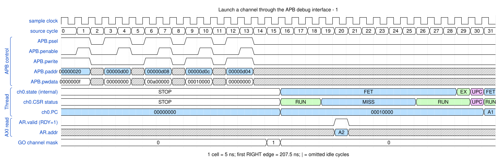

# Launch a channel through the APB debug interface

<!-- reading-nav -->
[Guide index](README.md) · [Background](00_background.md) · [Next: 2. Copy a four-beat memory burst and report completion →](02_copy.md)
<!-- /reading-nav -->

## Purpose

Start one channel at a known program address, then distinguish code fetching from source-data reads.

## Starting conditions

Place the program at 0x00010000. Enable E0 as an interrupt. Poll DBGSTATUS, stage DMAGO in DBGINST0/1, then write DBGCMD.

## Minimal sequence

The sequence below is an explanatory sketch. The recorded assembler may emit extra CCR updates or loop setup. The source-run name below identifies the reproducible simulation.

```text
CPU: INTEN <- 0x0000000f
CPU: poll DBGSTATUS == 0
CPU: DBGINST0 <- 0x00a00000
CPU: DBGINST1 <- 0x00010000
CPU: DBGCMD <- 0
Manager: DMAGO C0, 0x00010000
```

## Read the waveform

1. APB setup/access completes before the staged instruction executes. PREADY=1 is retained as context rather than repeated on every idle cycle.
2. The manager supplies GO and the channel enters FETCH at the programmed PC.
3. ARID=f fetches a 32-byte instruction-cache line. These bytes are code; the payload source has not yet been read.
4. The first DMAMOV begins execution after instruction delivery. The subsequent copy is explained separately.

Group brackets separate the thread, shared storage and active interfaces. Inactive interfaces and uninformative constant rows are omitted. A constant needed to explain a stall or security decision stays visible. Pastel state colors distinguish execution, waiting and faults; equal payload values share a color across read/write rows. [WaveDrom conventions and color legend](00_conventions.md) define cell timing, data labels and snapshots.

### Waveform 1

[](../svg/01_launch_1.svg)

[Open SVG at full size](../svg/01_launch_1.svg) | [WaveDrom JSON](../wavejson/01_launch_1.json)

Arm CSR labels: `STOP` = Stopped (`0x0`); `EXEC` = Executing (`0x1`); `MISS` = Cache miss (`0x2`); `UPC` = Updating PC (`0x3`).

Source: `direct_copy8`. Core/unit cycle snapshots cover the selected **205..365 ns** interval. The first cell's right sampling edge is **207.5 ns**.

| Exact VCD time (ns) | Milestone | Meaning |
|---:|---|---|

Full values for the short labels in this picture (matching D labels mean matching data):

| Label | Signal(s) | Full value |
|---|---|---|
| A1 | ch0.PC | `00010006` |
| A2 | AR.addr | `00010000` |

Useful constant context: `APB.pready=1`; `AR.ready=1 (no back-pressure)`; `AR.len=03`.

## Result and rule to remember

A successful DMAGO launches instruction execution; it does not itself copy bytes or guarantee a completion interrupt.

## Design reference

TRM Chapter 3 debug registers; Chapter 4 DMAGO and DMAMOV.

For source tests, reproduction commands and validation scope, see [Reproduction and validation](99_validation.md).

---

<!-- reading-nav -->
[Guide index](README.md) · [Background](00_background.md) · [Next: 2. Copy a four-beat memory burst and report completion →](02_copy.md)
<!-- /reading-nav -->
