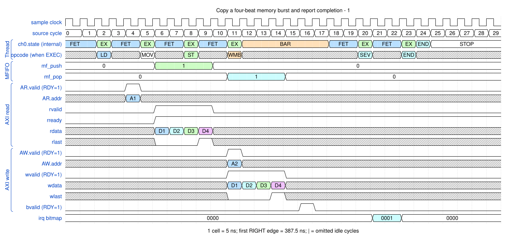

# Copy a four-beat memory burst and report completion

<!-- reading-nav -->
[Guide index](README.md) · [Background](00_background.md) · [← Previous: 1. Launch a channel through the APB debug interface](01_launch.md) · [Next: 3. Pack and unpack between different beat widths →](03_packing.md)
<!-- /reading-nav -->

## Purpose

Follow one load/store pair through the MFIFO, AXI response and completion event.

## Starting conditions

Channel 0; source 0x10000000; destination 0x20000000; four beats of eight bytes; both sides INCR.

## Minimal sequence

The sequence below is an explanatory sketch. The recorded assembler may emit extra CCR updates or loop setup. The source-run name below identifies the reproducible simulation.

```text
DMAMOV SAR, 0x10000000
DMAMOV DAR, 0x20000000
DMAMOV CCR, source_and_destination_4x8B
DMALD
DMAST
DMAWMB
DMASEV E0
DMAEND
```

## Read the waveform

1. DMALD submits the read. ARLEN=3 means four accepted beats, not three.
2. Each R beat appends bytes to this channel's MFIFO. The read is complete only on accepted RLAST.
3. The write scheduler waits for the full write payload. Matching D labels on RDATA and WDATA denote the same 64-bit value.
4. W supplies four beats; B reports the write response. DMAWMB waits for the outstanding writes before DMASEV E0.
5. IRQ is the program's completion notification; DMAEND subsequently stops the thread.

Group brackets separate the thread, shared storage and active interfaces. Inactive interfaces and uninformative constant rows are omitted. A constant needed to explain a stall or security decision stays visible. Pastel state colors distinguish execution, waiting and faults; equal payload values share a color across read/write rows. [WaveDrom conventions and color legend](00_conventions.md) define cell timing, data labels and snapshots.

### Waveform 1

[](../svg/02_copy_1.svg)

[Open SVG at full size](../svg/02_copy_1.svg) | [WaveDrom JSON](../wavejson/02_copy_1.json)

Arm CSR labels: `STOP` = Stopped (`0x0`); `EXEC` = Executing (`0x1`); `UPC` = Updating PC (`0x3`); `BAR` = At barrier (`0x5`); `COMP` = Completing (`0x9`).

Source: `direct_copy32`. Core/unit cycle snapshots cover the selected **377.5..527.5 ns** interval. The first cell's right sampling edge is **377.5 ns**.

| Exact VCD time (ns) | Milestone | Meaning |
|---:|---|---|
| 397.5 | AR accepted | ID=0; address=0x10000000; 4 beats x 8 B; INCR |
| 422.5 | RLAST accepted | RESP=0 |
| 432.5 | AW accepted | ID=0; address=0x20000000; 4 beats x 8 B; INCR |
| 452.5 | WLAST accepted | WSTRB=0xff |
| 457.5 | B response accepted | RESP=0 |
| 472.5 | IRQ bitmap | 0x1 |

Full values for the short labels in this picture (matching D labels mean matching data):

| Label | Signal(s) | Full value |
|---|---|---|
| A1 | AR.addr | `10000000` |
| A2 | AW.addr | `20000000` |
| D1 | rdata, wdata | `4d4c4f4e49484b4a` |
| D2 | rdata, wdata | `4544474641404342` |
| D3 | rdata, wdata | `5d5c5f5e59585b5a` |
| D4 | rdata, wdata | `5554575651505352` |

Useful constant context: `AR.ready=1 (no back-pressure)`; `AR.len=03`; `AW.ready=1 (no back-pressure)`; `AW.len=03`; `wready=1 (no back-pressure)`; `wstrb=ff`; `bready=1 (no back-pressure)`.

## Result and rule to remember

Byte order is preserved and completion follows write retirement. Address submission, WLAST, B and IRQ are different milestones.

## Design reference

TRM §§2.10.7-2.10.8; DMALD, DMAST, DMAWMB, DMASEV.

For source tests, reproduction commands and validation scope, see [Reproduction and validation](99_validation.md).

---

<!-- reading-nav -->
[Guide index](README.md) · [Background](00_background.md) · [← Previous: 1. Launch a channel through the APB debug interface](01_launch.md) · [Next: 3. Pack and unpack between different beat widths →](03_packing.md)
<!-- /reading-nav -->
