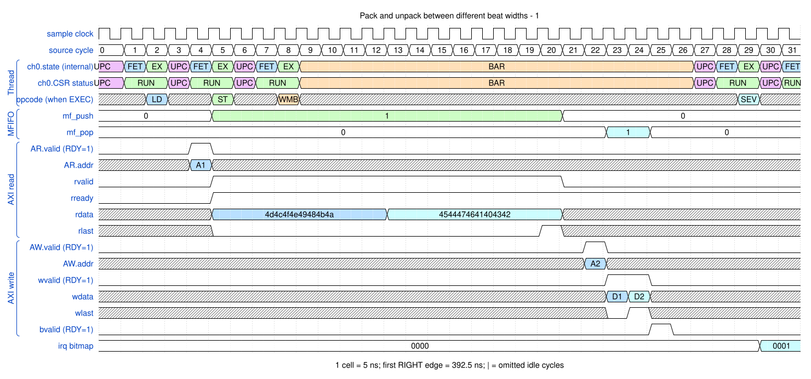
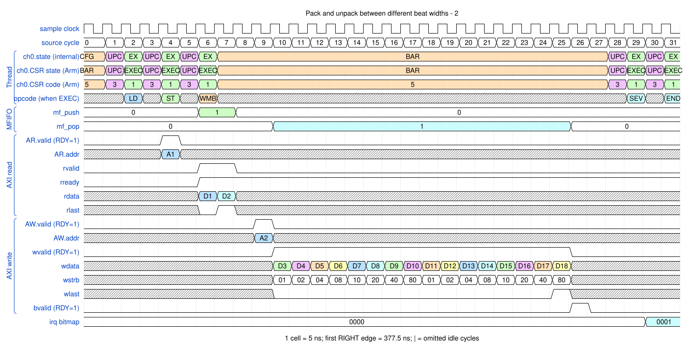

# Pack and unpack between different beat widths

<!-- reading-nav -->
[Guide index](README.md) · [Background](00_background.md) · [← Previous: 2. Copy a four-beat memory burst and report completion](02_copy.md) · [Next: 4. Copy between different byte alignments →](04_unaligned.md)
<!-- /reading-nav -->


## Purpose

See why source and destination beat counts can differ while the byte stream is preserved.

## Starting conditions

Both examples move sixteen bytes. The first uses sixteen 1-byte reads and two 8-byte writes; the second reverses those shapes.

## Minimal sequence

The sequence below is an explanatory sketch. The recorded assembler may emit extra CCR updates or loop setup. The source-run name below identifies the reproducible simulation.

```text
DMAMOV CCR, independent_source_and_destination_shapes
DMALD
DMAST
DMAWMB
DMASEV E0
DMAEND
```

## Read the waveform

1. In the packing example, sixteen narrow R beats feed one channel byte stream; two wide W beats consume it.
2. In the unpacking example, two wide R beats feed sixteen narrow W beats.
3. WSTRB selects the destination lane of each narrow transfer. Unselected WDATA bytes are irrelevant.
4. Compare payload bytes, not physical bus beat counts. The MFIFO bridges the two transfer shapes.

Group brackets separate the thread, shared storage and active interfaces. Inactive interfaces and uninformative constant rows are omitted. A constant needed to explain a stall or security decision stays visible. Pastel state colors distinguish execution, waiting and faults; equal payload values share a color across read/write rows. [WaveDrom conventions and color legend](00_conventions.md) define cell timing, data labels and snapshots.

### Waveform 1

[](../svg/03_packing_1.svg)

[Open SVG at full size](../svg/03_packing_1.svg) | [WaveDrom JSON](../wavejson/03_packing_1.json)

Source: `direct_pack`. Core/unit cycle snapshots cover the selected **387.5..547.5 ns** interval. The first cell's right sampling edge is **387.5 ns**.

| Exact VCD time (ns) | Milestone | Meaning |
|---:|---|---|
| 407.5 | AR accepted | ID=0; address=0x10000000; 16 beats x 1 B; INCR |
| 492.5 | RLAST accepted | RESP=0 |
| 502.5 | AW accepted | ID=0; address=0x20000000; 2 beats x 8 B; INCR |
| 507.5 | WLAST accepted | WSTRB=0xff |
| 517.5 | B response accepted | RESP=0 |
| 537.5 | IRQ bitmap | 0x1 |

Full values for the short labels in this picture (matching D labels mean matching data):

| Label | Signal(s) | Full value |
|---|---|---|
| A1 | AR.addr | `10000000` |
| A2 | AW.addr | `20000000` |
| D1 | wdata | `4d4c4f4e49484b4a` |
| D2 | wdata | `4544474641404342` |

Useful constant context: `AR.ready=1 (no back-pressure)`; `AR.len=0f`; `AW.ready=1 (no back-pressure)`; `AW.len=01`; `wready=1 (no back-pressure)`; `wstrb=ff`; `bready=1 (no back-pressure)`.

### Waveform 2

[](../svg/03_packing_2.svg)

[Open SVG at full size](../svg/03_packing_2.svg) | [WaveDrom JSON](../wavejson/03_packing_2.json)

Source: `direct_unpack`. Core/unit cycle snapshots cover the selected **387.5..547.5 ns** interval. The first cell's right sampling edge is **387.5 ns**.

| Exact VCD time (ns) | Milestone | Meaning |
|---:|---|---|
| 407.5 | AR accepted | ID=0; address=0x10000000; 2 beats x 8 B; INCR |
| 422.5 | RLAST accepted | RESP=0 |
| 437.5 | AW accepted | ID=0; address=0x20000000; 16 beats x 1 B; INCR |
| 512.5 | WLAST accepted | WSTRB=0x80 |
| 517.5 | B response accepted | RESP=0 |
| 537.5 | IRQ bitmap | 0x1 |

Full values for the short labels in this picture (matching D labels mean matching data):

| Label | Signal(s) | Full value |
|---|---|---|
| A1 | AR.addr | `10000000` |
| A2 | AW.addr | `20000000` |
| D1 | rdata | `4d4c4f4e49484b4a` |
| D2 | rdata | `4544474641404342` |
| D3 | wdata | `000000000000004a` |
| D4 | wdata | `0000000000004b00` |
| D5 | wdata | `0000000000480000` |
| D6 | wdata | `0000000049000000` |
| D7 | wdata | `0000004e00000000` |
| D8 | wdata | `00004f0000000000` |
| D9 | wdata | `004c000000000000` |
| D10 | wdata | `4d00000000000000` |
| D11 | wdata | `0000000000000042` |
| D12 | wdata | `0000000000004300` |
| D13 | wdata | `0000000000400000` |
| D14 | wdata | `0000000041000000` |
| D15 | wdata | `0000004600000000` |
| D16 | wdata | `0000470000000000` |
| D17 | wdata | `0044000000000000` |
| D18 | wdata | `4500000000000000` |

Useful constant context: `AR.ready=1 (no back-pressure)`; `AR.len=01`; `AW.ready=1 (no back-pressure)`; `AW.len=0f`; `wready=1 (no back-pressure)`; `bready=1 (no back-pressure)`.

## Result and rule to remember

The operation conserves bytes and ordering, not the number of read/write beats.

## Design reference

TRM CCR and load/store instructions; workspace byte-stream datapath.

For source tests, reproduction commands and validation scope, see [Reproduction and validation](99_validation.md).

---

<!-- reading-nav -->
[Guide index](README.md) · [Background](00_background.md) · [← Previous: 2. Copy a four-beat memory burst and report completion](02_copy.md) · [Next: 4. Copy between different byte alignments →](04_unaligned.md)
<!-- /reading-nav -->
