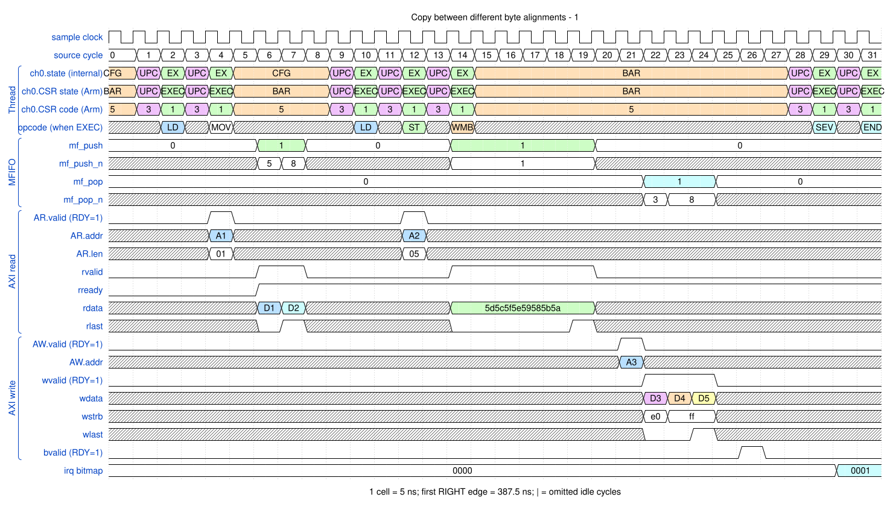

# Copy between different byte alignments

<!-- reading-nav -->
[Guide index](README.md) · [Background](00_background.md) · [← Previous: 3. Pack and unpack between different beat widths](03_packing.md) · [Next: 5. Split one instruction burst at a 4 KB boundary →](05_boundary.md)
<!-- /reading-nav -->

## Purpose

Explain source lane extraction, destination lane placement and a short tail.

## Starting conditions

Copy nineteen bytes from 0x10000003 to 0x20000005. Source and destination begin at different lanes of the 64-bit bus.

## Minimal sequence

The sequence below is an explanatory sketch. The recorded assembler may emit extra CCR updates or loop setup. The source-run name below identifies the reproducible simulation.

```text
DMAMOV SAR, 0x10000003
DMAMOV DAR, 0x20000005
; emitted CCR/LD/ST shapes cover exactly 19 bytes
DMAWMB
DMASEV E0
DMAEND
```

## Read the waveform

1. The first eight-byte-sized source beat contributes lanes 3..7, only five useful bytes. Here the first LD supplies 5+8=13 bytes, then a six-beat byte-sized LD supplies the remaining six bytes.
2. The first destination beat begins at lane 5, so only its asserted WSTRB lanes belong to the copy.
3. Source and destination need different burst/tail shapes. The generator may rewrite CCR between them.
4. Read hexadecimal WDATA from the low byte lane upward, then apply WSTRB before comparing with the source stream.

Group brackets separate the thread, shared storage and active interfaces. Inactive interfaces and uninformative constant rows are omitted. A constant needed to explain a stall or security decision stays visible. Pastel state colors distinguish execution, waiting and faults; equal payload values share a color across read/write rows. [WaveDrom conventions and color legend](00_conventions.md) define cell timing, data labels and snapshots.

### Waveform 1

[](../svg/04_unaligned_1.svg)

[Open SVG at full size](../svg/04_unaligned_1.svg) | [WaveDrom JSON](../wavejson/04_unaligned_1.json)

Arm CSR labels: `EXEC` = Executing (`0x1`); `UPC` = Updating PC (`0x3`); `BAR` = At barrier (`0x5`).

Source: `direct_unaligned`. Core/unit cycle snapshots cover the selected **387.5..547.5 ns** interval. The first cell's right sampling edge is **387.5 ns**.

| Exact VCD time (ns) | Milestone | Meaning |
|---:|---|---|
| 407.5 | AR accepted | ID=0; address=0x10000003; 2 beats x 8 B; INCR |
| 422.5 | RLAST accepted | RESP=0 |
| 447.5 | AR accepted | ID=0; address=0x10000010; 6 beats x 1 B; INCR |
| 482.5 | RLAST accepted | RESP=0 |
| 492.5 | AW accepted | ID=0; address=0x20000005; 3 beats x 8 B; INCR |
| 507.5 | WLAST accepted | WSTRB=0xff |
| 517.5 | B response accepted | RESP=0 |
| 532.5 | IRQ bitmap | 0x1 |

Full values for the short labels in this picture (matching D labels mean matching data):

| Label | Signal(s) | Full value |
|---|---|---|
| A1 | AR.addr | `10000003` |
| A2 | AR.addr | `10000010` |
| A3 | AW.addr | `20000005` |
| D1 | rdata | `4d4c4f4e49484b4a` |
| D2 | rdata | `4544474641404342` |
| D3 | wdata | `4f4e490000000000` |
| D4 | wdata | `4746414043424d4c` |
| D5 | wdata | `5f5e59585b5a4544` |

Useful constant context: `AR.ready=1 (no back-pressure)`; `AW.ready=1 (no back-pressure)`; `AW.len=02`; `wready=1 (no back-pressure)`; `bready=1 (no back-pressure)`.

## Result and rule to remember

Exactly nineteen bytes are copied without treating invalid lanes as payload.

## Design reference

TRM §§2.10.4, 2.11; SAR/DAR/CCR and load/store instructions.

For source tests, reproduction commands and validation scope, see [Reproduction and validation](99_validation.md).

---

<!-- reading-nav -->
[Guide index](README.md) · [Background](00_background.md) · [← Previous: 3. Pack and unpack between different beat widths](03_packing.md) · [Next: 5. Split one instruction burst at a 4 KB boundary →](05_boundary.md)
<!-- /reading-nav -->
