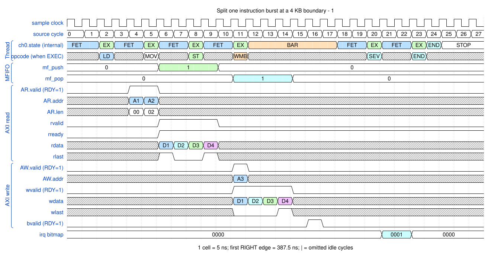
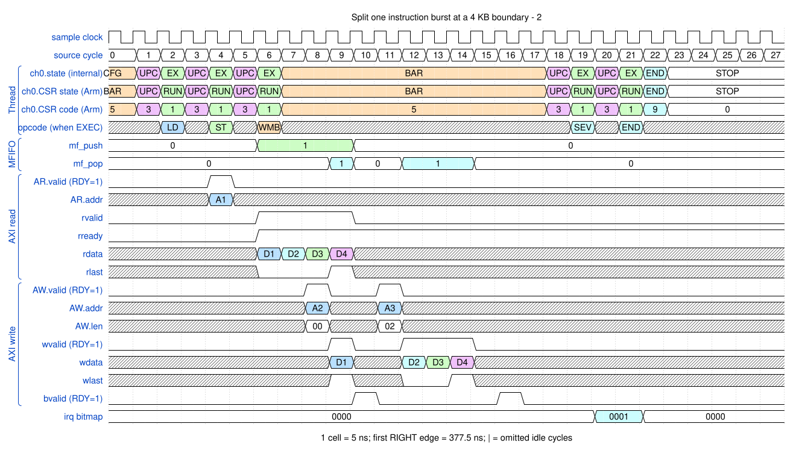

# Split one instruction burst at a 4 KB boundary

<!-- reading-nav -->
[Guide index](README.md) · [Background](00_background.md) · [← Previous: 4. Copy between different byte alignments](04_unaligned.md) · [Next: 6. Use a fixed source or a fixed destination →](06_fixed.md)
<!-- /reading-nav -->


## Purpose

Distinguish one DMA instruction from the two AXI transactions it generates.

## Starting conditions

The requested payload is four 8-byte beats. Either SAR or DAR starts at page offset 0xff8.

## Minimal sequence

The sequence below is an explanatory sketch. The recorded assembler may emit extra CCR updates or loop setup. The source-run name below identifies the reproducible simulation.

```text
DMAMOV SAR_or_DAR, page_base + 0xff8
DMAMOV CCR, 4_beats_of_8_bytes
DMALD
DMAST
DMAWMB
```

## Read the waveform

1. The first transaction ends at the old page: address ...0ff8, LEN=0, eight bytes.
2. The second starts at ...1000: LEN=2, twenty-four bytes.
3. On the read side each transaction has its own RLAST. On the write side each has WLAST and a separate B response.
4. The channel still executed one LD or ST for the split descriptor. The barrier accounts for both write transactions.

Group brackets separate the thread, shared storage and active interfaces. Inactive interfaces and uninformative constant rows are omitted. A constant needed to explain a stall or security decision stays visible. Pastel state colors distinguish execution, waiting and faults; equal payload values share a color across read/write rows. [WaveDrom conventions and color legend](00_conventions.md) define cell timing, data labels and snapshots.

### Waveform 1

[](../svg/05_boundary_1.svg)

[Open SVG at full size](../svg/05_boundary_1.svg) | [WaveDrom JSON](../wavejson/05_boundary_1.json)

Source: `direct_read4k`. Core/unit cycle snapshots cover the selected **387.5..527.5 ns** interval. The first cell's right sampling edge is **387.5 ns**.

| Exact VCD time (ns) | Milestone | Meaning |
|---:|---|---|
| 407.5 | AR accepted | ID=0; address=0x10000ff8; 1 beats x 8 B; INCR |
| 412.5 | AR accepted | ID=0; address=0x10001000; 3 beats x 8 B; INCR |
| 417.5 | RLAST accepted | RESP=0 |
| 432.5 | RLAST accepted | RESP=0 |
| 442.5 | AW accepted | ID=0; address=0x20000000; 4 beats x 8 B; INCR |
| 457.5 | WLAST accepted | WSTRB=0xff |
| 467.5 | B response accepted | RESP=0 |
| 487.5 | IRQ bitmap | 0x1 |

Full values for the short labels in this picture (matching D labels mean matching data):

| Label | Signal(s) | Full value |
|---|---|---|
| A1 | AR.addr | `10000ff8` |
| A2 | AR.addr | `10001000` |
| A3 | AW.addr | `20000000` |
| D1 | rdata, wdata | `babbb8b9bebfbcbd` |
| D2 | rdata, wdata | `5d5c5f5e59585b5a` |
| D3 | rdata, wdata | `5554575651505352` |
| D4 | rdata, wdata | `4d4c4f4e49484b4a` |

Useful constant context: `AR.ready=1 (no back-pressure)`; `AW.ready=1 (no back-pressure)`; `AW.len=03`; `wready=1 (no back-pressure)`; `wstrb=ff`; `bready=1 (no back-pressure)`.

### Waveform 2

[](../svg/05_boundary_2.svg)

[Open SVG at full size](../svg/05_boundary_2.svg) | [WaveDrom JSON](../wavejson/05_boundary_2.json)

Source: `direct_write4k`. Core/unit cycle snapshots cover the selected **387.5..527.5 ns** interval. The first cell's right sampling edge is **387.5 ns**.

| Exact VCD time (ns) | Milestone | Meaning |
|---:|---|---|
| 407.5 | AR accepted | ID=0; address=0x10000000; 4 beats x 8 B; INCR |
| 432.5 | RLAST accepted | RESP=0 |
| 437.5 | AW accepted | ID=0; address=0x20000ff8; 1 beats x 8 B; INCR |
| 437.5 | WLAST accepted | WSTRB=0xff |
| 442.5 | AW accepted | ID=0; address=0x20001000; 3 beats x 8 B; INCR |
| 447.5 | B response accepted | RESP=0 |
| 452.5 | WLAST accepted | WSTRB=0xff |
| 457.5 | B response accepted | RESP=0 |
| 477.5 | IRQ bitmap | 0x1 |

Full values for the short labels in this picture (matching D labels mean matching data):

| Label | Signal(s) | Full value |
|---|---|---|
| A1 | AR.addr | `10000000` |
| A2 | AW.addr | `20000ff8` |
| A3 | AW.addr | `20001000` |
| D1 | rdata, wdata | `4d4c4f4e49484b4a` |
| D2 | rdata, wdata | `4544474641404342` |
| D3 | rdata, wdata | `5d5c5f5e59585b5a` |
| D4 | rdata, wdata | `5554575651505352` |

Useful constant context: `AR.ready=1 (no back-pressure)`; `AR.len=03`; `AW.ready=1 (no back-pressure)`; `wready=1 (no back-pressure)`; `wstrb=ff`; `bready=1 (no back-pressure)`.

## Result and rule to remember

The bus never crosses 4 KB in one INCR burst; 8+24 bytes still implement the requested 32-byte transfer.

## Design reference

TRM §2.10.5.

For source tests, reproduction commands and validation scope, see [Reproduction and validation](99_validation.md).

---

<!-- reading-nav -->
[Guide index](README.md) · [Background](00_background.md) · [← Previous: 4. Copy between different byte alignments](04_unaligned.md) · [Next: 6. Use a fixed source or a fixed destination →](06_fixed.md)
<!-- /reading-nav -->
