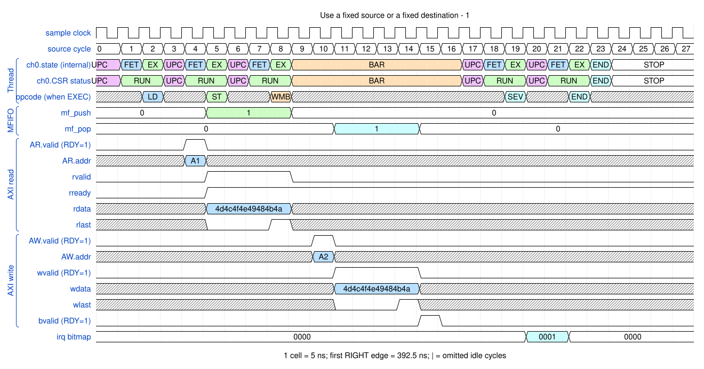
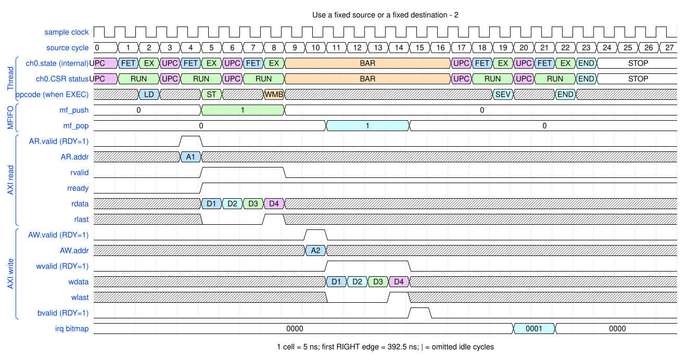

# Use a fixed source or a fixed destination

<!-- reading-nav -->
[Guide index](README.md) · [Background](00_background.md) · [← Previous: 5. Split one instruction burst at a 4 KB boundary](05_boundary.md) · [Next: 7. Fill memory with DMASTZ →](07_zero.md)
<!-- /reading-nav -->


## Purpose

Understand FIXED addressing independently from whether the data changes.

## Starting conditions

Four aligned eight-byte beats. The first example fixes the source; the second fixes the destination.

## Minimal sequence

The sequence below is an explanatory sketch. The recorded assembler may emit extra CCR updates or loop setup. The source-run name below identifies the reproducible simulation.

```text
DMAMOV CCR, source_FIXED_destination_INCR
; or source_INCR_destination_FIXED
DMALD
DMAST
DMAWMB
```

## Read the waveform

1. FIXED means each beat accesses the same address. It does not require constant payload.
2. A RAM model returns repeated memory bytes for repeated fixed-address reads; a real FIFO can return a new element on each read.
3. Repeated fixed-address RAM writes overwrite earlier bytes. A peripheral FIFO instead consumes each write.
4. The other side can independently use INCR. Only aligned FIXED examples are used here.

Group brackets separate the thread, shared storage and active interfaces. Inactive interfaces and uninformative constant rows are omitted. A constant needed to explain a stall or security decision stays visible. Pastel state colors distinguish execution, waiting and faults; equal payload values share a color across read/write rows. [WaveDrom conventions and color legend](00_conventions.md) define cell timing, data labels and snapshots.

### Waveform 1

[](../svg/06_fixed_1.svg)

[Open SVG at full size](../svg/06_fixed_1.svg) | [WaveDrom JSON](../wavejson/06_fixed_1.json)

Source: `direct_fixed_source`. Core/unit cycle snapshots cover the selected **387.5..527.5 ns** interval. The first cell's right sampling edge is **387.5 ns**.

| Exact VCD time (ns) | Milestone | Meaning |
|---:|---|---|
| 407.5 | AR accepted | ID=0; address=0x10000000; 4 beats x 8 B; FIXED |
| 432.5 | RLAST accepted | RESP=0 |
| 442.5 | AW accepted | ID=0; address=0x20000000; 4 beats x 8 B; INCR |
| 457.5 | WLAST accepted | WSTRB=0xff |
| 467.5 | B response accepted | RESP=0 |
| 487.5 | IRQ bitmap | 0x1 |

Full values for the short labels in this picture (matching D labels mean matching data):

| Label | Signal(s) | Full value |
|---|---|---|
| A1 | AR.addr | `10000000` |
| A2 | AW.addr | `20000000` |

Useful constant context: `AR.ready=1 (no back-pressure)`; `AR.len=03`; `AW.ready=1 (no back-pressure)`; `AW.len=03`; `wready=1 (no back-pressure)`; `wstrb=ff`; `bready=1 (no back-pressure)`.

### Waveform 2

[](../svg/06_fixed_2.svg)

[Open SVG at full size](../svg/06_fixed_2.svg) | [WaveDrom JSON](../wavejson/06_fixed_2.json)

Source: `direct_fixed_dest`. Core/unit cycle snapshots cover the selected **387.5..527.5 ns** interval. The first cell's right sampling edge is **387.5 ns**.

| Exact VCD time (ns) | Milestone | Meaning |
|---:|---|---|
| 407.5 | AR accepted | ID=0; address=0x10000000; 4 beats x 8 B; INCR |
| 432.5 | RLAST accepted | RESP=0 |
| 442.5 | AW accepted | ID=0; address=0x20000000; 4 beats x 8 B; FIXED |
| 457.5 | WLAST accepted | WSTRB=0xff |
| 467.5 | B response accepted | RESP=0 |
| 487.5 | IRQ bitmap | 0x1 |

Full values for the short labels in this picture (matching D labels mean matching data):

| Label | Signal(s) | Full value |
|---|---|---|
| A1 | AR.addr | `10000000` |
| A2 | AW.addr | `20000000` |
| D1 | rdata, wdata | `4d4c4f4e49484b4a` |
| D2 | rdata, wdata | `4544474641404342` |
| D3 | rdata, wdata | `5d5c5f5e59585b5a` |
| D4 | rdata, wdata | `5554575651505352` |

Useful constant context: `AR.ready=1 (no back-pressure)`; `AR.len=03`; `AW.ready=1 (no back-pressure)`; `AW.len=03`; `wready=1 (no back-pressure)`; `wstrb=ff`; `bready=1 (no back-pressure)`.

## Result and rule to remember

Address progression is controlled separately for source and destination.

## Design reference

TRM §§2.10.6 and 2.11.1.

For source tests, reproduction commands and validation scope, see [Reproduction and validation](99_validation.md).

---

<!-- reading-nav -->
[Guide index](README.md) · [Background](00_background.md) · [← Previous: 5. Split one instruction burst at a 4 KB boundary](05_boundary.md) · [Next: 7. Fill memory with DMASTZ →](07_zero.md)
<!-- /reading-nav -->
