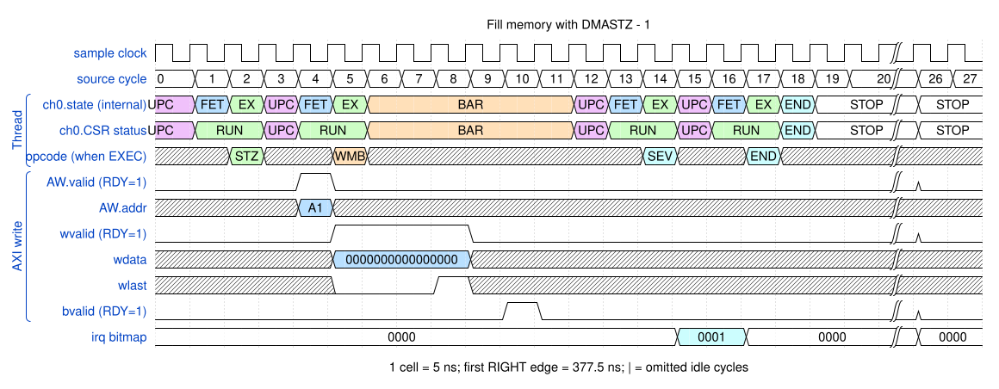

# Fill memory with DMASTZ

<!-- reading-nav -->
[Guide index](README.md) · [Background](00_background.md) · [← Previous: 6. Use a fixed source or a fixed destination](06_fixed.md) · [Next: 8. Build a two-dimensional copy using loops and address arithmetic →](08_loops.md)
<!-- /reading-nav -->

## Purpose

Show a write operation that does not consume a loaded payload stream.

## Starting conditions

Destination 0x20000000; four eight-byte INCR beats. No data DMALD precedes DMASTZ.

## Minimal sequence

The sequence below is an explanatory sketch. The recorded assembler may emit extra CCR updates or loop setup. The source-run name below identifies the reproducible simulation.

```text
DMAMOV DAR, 0x20000000
DMAMOV CCR, destination_4x8B
DMASTZ
DMAWMB
DMASEV E0
DMAEND
```

## Read the waveform

1. DMASTZ constructs zero-valued write payload without reading a source buffer.
2. AW describes the destination and W supplies four zero beats with the appropriate strobes.
3. The MFIFO does not need loaded data for this zero store.
4. Code-fetch reads are omitted from this data-focused picture; their presence in the VCD is normal.

Group brackets separate the thread, shared storage and active interfaces. Inactive interfaces and uninformative constant rows are omitted. A constant needed to explain a stall or security decision stays visible. Pastel state colors distinguish execution, waiting and faults; equal payload values share a color across read/write rows. [WaveDrom conventions and color legend](00_conventions.md) define cell timing, data labels and snapshots.

### Waveform 1

[](../svg/07_zero_1.svg)

[Open SVG at full size](../svg/07_zero_1.svg) | [WaveDrom JSON](../wavejson/07_zero_1.json)

Source: `direct_zero`. Core/unit cycle snapshots cover the selected **367.5..507.5 ns** interval. The first cell's right sampling edge is **367.5 ns**.

| Exact VCD time (ns) | Milestone | Meaning |
|---:|---|---|
| 387.5 | AW accepted | ID=0; address=0x20000000; 4 beats x 8 B; INCR |
| 407.5 | WLAST accepted | WSTRB=0xff |
| 417.5 | B response accepted | RESP=0 |
| 432.5 | IRQ bitmap | 0x1 |

Full values for the short labels in this picture (matching D labels mean matching data):

| Label | Signal(s) | Full value |
|---|---|---|
| A1 | AW.addr | `20000000` |

Useful constant context: `AW.ready=1 (no back-pressure)`; `AW.len=03`; `wready=1 (no back-pressure)`; `wstrb=ff`; `bready=1 (no back-pressure)`.

## Result and rule to remember

Zero fill follows normal write-response/barrier completion even though there is no payload read.

## Design reference

TRM DMASTZ and DMAWMB.

For source tests, reproduction commands and validation scope, see [Reproduction and validation](99_validation.md).

---

<!-- reading-nav -->
[Guide index](README.md) · [Background](00_background.md) · [← Previous: 6. Use a fixed source or a fixed destination](06_fixed.md) · [Next: 8. Build a two-dimensional copy using loops and address arithmetic →](08_loops.md)
<!-- /reading-nav -->
