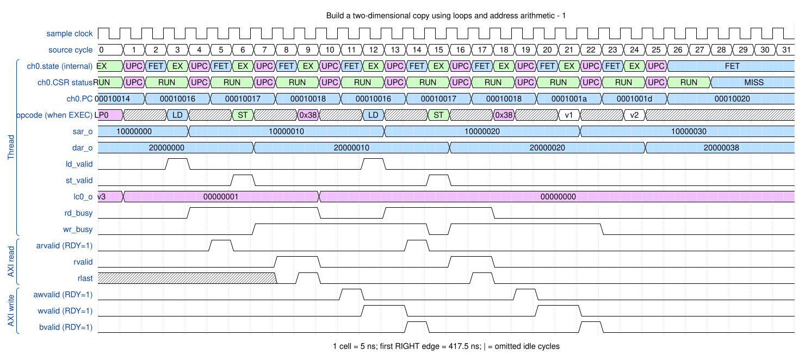
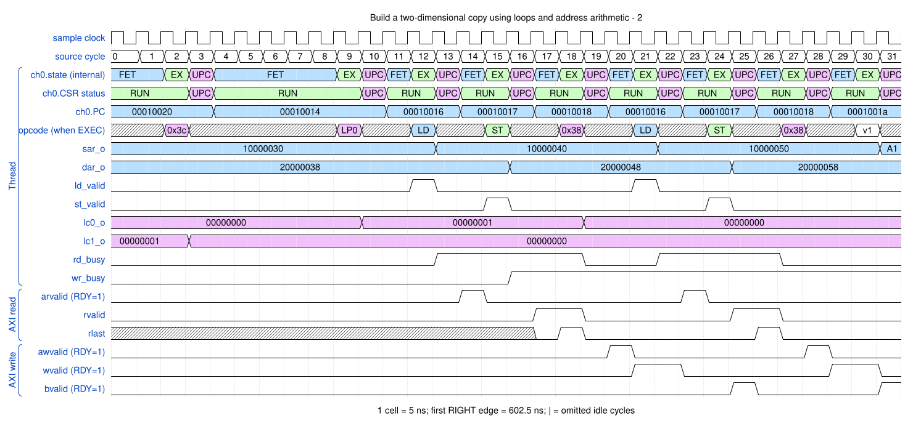

# Build a two-dimensional copy using loops and address arithmetic

<!-- reading-nav -->
[Guide index](README.md) · [Background](00_background.md) · [← Previous: 7. Fill memory with DMASTZ](07_zero.md) · [Next: 9. Reverse bytes inside endian-swap groups →](09_endian.md)
<!-- /reading-nav -->

## Purpose

Follow the inner burst loop and the row-to-row stride update.

## Starting conditions

Two rows, two 16-byte bursts per row. Source gap=16 bytes, destination gap=24 bytes; row strides are 48 and 56 bytes.

## Minimal sequence

The sequence below is an explanatory sketch. The recorded assembler may emit extra CCR updates or loop setup. The source-run name below identifies the reproducible simulation.

```text
DMALP LC1, 2
  DMALP LC0, 2
    DMALD
    DMAST
  DMALPEND LC0
  DMAADDH SAR, 16
  DMAADDH DAR, 24
DMALPEND LC1
DMAWMB
DMASEV E0
DMAEND
```

## Read the waveform

1. LC0 controls bursts within a row; LC1 controls rows. A backward PC jump is program flow, not a backwards AXI burst.
2. Each inner iteration moves sixteen bytes; SAR/DAR advance as descriptors are accepted.
3. After the first row, DMAADDH adds the gaps. The next row starts 48 source bytes and 56 destination bytes after the previous row start.
4. Arithmetic after the final row still executes. Final architectural addresses need not equal the final bus beat address.

Group brackets separate the thread, shared storage and active interfaces. Inactive interfaces and uninformative constant rows are omitted. A constant needed to explain a stall or security decision stays visible. Pastel state colors distinguish execution, waiting and faults; equal payload values share a color across read/write rows. [WaveDrom conventions and color legend](00_conventions.md) define cell timing, data labels and snapshots.

### Waveform 1

[](../svg/08_loops_1.svg)

[Open SVG at full size](../svg/08_loops_1.svg) | [WaveDrom JSON](../wavejson/08_loops_1.json)

Source: `direct_loop2d`. Core/unit cycle snapshots cover the selected **417.5..577.5 ns** interval. The first cell's right sampling edge is **417.5 ns**.

| Exact VCD time (ns) | Milestone | Meaning |
|---:|---|---|
| 442.5 | AR accepted | ID=0; address=0x10000000; 2 beats x 8 B; INCR |
| 462.5 | RLAST accepted | RESP=0 |
| 472.5 | AW accepted | ID=0; address=0x20000000; 2 beats x 8 B; INCR |
| 482.5 | WLAST accepted | WSTRB=0xff |
| 487.5 | AR accepted | ID=0; address=0x10000010; 2 beats x 8 B; INCR |
| 487.5 | B response accepted | RESP=0 |
| 502.5 | RLAST accepted | RESP=0 |
| 512.5 | AW accepted | ID=0; address=0x20000010; 2 beats x 8 B; INCR |
| 522.5 | WLAST accepted | WSTRB=0xff |
| 527.5 | B response accepted | RESP=0 |

Full values for the short labels in this picture (matching D labels mean matching data):

| Label | Signal(s) | Full value |
|---|---|---|
| v1 | opcode (when EXEC) | `ADDH-S` |
| v2 | opcode (when EXEC) | `ADDH-D` |
| v3 | lc0_o | `00000000` |

Useful constant context: `ccr_o=0005c017`; `arready=1 (no back-pressure)`; `awready=1 (no back-pressure)`; `wready=1 (no back-pressure)`.

### Waveform 2

[](../svg/08_loops_2.svg)

[Open SVG at full size](../svg/08_loops_2.svg) | [WaveDrom JSON](../wavejson/08_loops_2.json)

Source: `direct_loop2d`. Core/unit cycle snapshots cover the selected **602.5..762.5 ns** interval. The first cell's right sampling edge is **602.5 ns**.

| Exact VCD time (ns) | Milestone | Meaning |
|---:|---|---|
| 672.5 | AR accepted | ID=0; address=0x10000030; 2 beats x 8 B; INCR |
| 692.5 | RLAST accepted | RESP=0 |
| 702.5 | AW accepted | ID=0; address=0x20000038; 2 beats x 8 B; INCR |
| 712.5 | WLAST accepted | WSTRB=0xff |
| 717.5 | AR accepted | ID=0; address=0x10000040; 2 beats x 8 B; INCR |
| 727.5 | B response accepted | RESP=0 |
| 732.5 | RLAST accepted | RESP=0 |
| 742.5 | AW accepted | ID=0; address=0x20000048; 2 beats x 8 B; INCR |
| 752.5 | WLAST accepted | WSTRB=0xff |
| 757.5 | B response accepted | RESP=0 |

Full values for the short labels in this picture (matching D labels mean matching data):

| Label | Signal(s) | Full value |
|---|---|---|
| v1 | opcode (when EXEC) | `ADDH-S` |
| A1 | sar_o | `10000060` |

Useful constant context: `ccr_o=0005c017`; `arready=1 (no back-pressure)`; `awready=1 (no back-pressure)`; `wready=1 (no back-pressure)`.

## Result and rule to remember

There is no dedicated 2D descriptor engine: the microprogram creates rows and strides.

## Design reference

TRM DMALP, DMALPEND, DMAADDH; the additional reverse2d teaching scenario uses DMAADNH for reverse rows.

For source tests, reproduction commands and validation scope, see [Reproduction and validation](99_validation.md).

---

<!-- reading-nav -->
[Guide index](README.md) · [Background](00_background.md) · [← Previous: 7. Fill memory with DMASTZ](07_zero.md) · [Next: 9. Reverse bytes inside endian-swap groups →](09_endian.md)
<!-- /reading-nav -->
