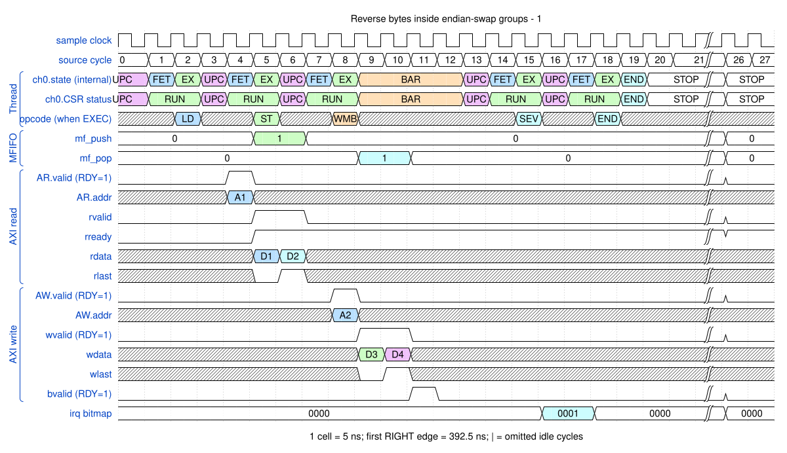
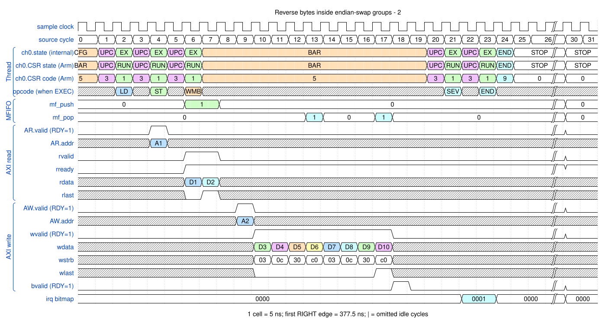

# Reverse bytes inside endian-swap groups

<!-- reading-nav -->
[Guide index](README.md) · [Background](00_background.md) · [← Previous: 8. Build a two-dimensional copy using loops and address arithmetic](08_loops.md) · [Next: 10. Service a memory-to-peripheral request →](10_m2p.md)
<!-- /reading-nav -->


## Purpose

Separate the swap group size from the physical AXI beat size.

## Starting conditions

First reverse four-byte groups on wide writes. Then reverse eight-byte groups while emitting two-byte W beats.

## Minimal sequence

The sequence below is an explanatory sketch. The recorded assembler may emit extra CCR updates or loop setup. The source-run name below identifies the reproducible simulation.

```text
DMAMOV CCR, endian_swap_32bit
DMALD
DMAST
; second example: swap_64bit, destination_2byte_beats
DMAWMB
```

## Read the waveform

1. For a four-byte group, 00 01 02 03 becomes 03 02 01 00. Group order is retained.
2. Actual seeded values are listed below each picture; D labels identify full data words in JSON.
3. With an eight-byte group and two-byte beats, four W beats consume one reversed group.
4. Addresses must be group-aligned and write bursts must contain whole groups. The group cannot exceed this implementation's data-bus width.

Group brackets separate the thread, shared storage and active interfaces. Inactive interfaces and uninformative constant rows are omitted. A constant needed to explain a stall or security decision stays visible. Pastel state colors distinguish execution, waiting and faults; equal payload values share a color across read/write rows. [WaveDrom conventions and color legend](00_conventions.md) define cell timing, data labels and snapshots.

### Waveform 1

[](../svg/09_endian_1.svg)

[Open SVG at full size](../svg/09_endian_1.svg) | [WaveDrom JSON](../wavejson/09_endian_1.json)

Source: `direct_swap32`. Core/unit cycle snapshots cover the selected **387.5..527.5 ns** interval. The first cell's right sampling edge is **387.5 ns**.

| Exact VCD time (ns) | Milestone | Meaning |
|---:|---|---|
| 407.5 | AR accepted | ID=0; address=0x10000000; 2 beats x 8 B; INCR |
| 422.5 | RLAST accepted | RESP=0 |
| 437.5 | AW accepted | ID=0; address=0x20000000; 2 beats x 8 B; INCR |
| 442.5 | WLAST accepted | WSTRB=0xff |
| 447.5 | B response accepted | RESP=0 |
| 467.5 | IRQ bitmap | 0x1 |

Full values for the short labels in this picture (matching D labels mean matching data):

| Label | Signal(s) | Full value |
|---|---|---|
| A1 | AR.addr | `10000000` |
| A2 | AW.addr | `20000000` |
| D1 | rdata | `4d4c4f4e49484b4a` |
| D2 | rdata | `4544474641404342` |
| D3 | wdata | `4e4f4c4d4a4b4849` |
| D4 | wdata | `4647444542434041` |

Useful constant context: `AR.ready=1 (no back-pressure)`; `AR.len=01`; `AW.ready=1 (no back-pressure)`; `AW.len=01`; `wready=1 (no back-pressure)`; `wstrb=ff`; `bready=1 (no back-pressure)`.

### Waveform 2

[](../svg/09_endian_2.svg)

[Open SVG at full size](../svg/09_endian_2.svg) | [WaveDrom JSON](../wavejson/09_endian_2.json)

Source: `direct_swap64_narrow`. Core/unit cycle snapshots cover the selected **387.5..547.5 ns** interval. The first cell's right sampling edge is **387.5 ns**.

| Exact VCD time (ns) | Milestone | Meaning |
|---:|---|---|
| 407.5 | AR accepted | ID=0; address=0x10000000; 2 beats x 8 B; INCR |
| 422.5 | RLAST accepted | RESP=0 |
| 437.5 | AW accepted | ID=0; address=0x20000000; 8 beats x 2 B; INCR |
| 472.5 | WLAST accepted | WSTRB=0xc0 |
| 477.5 | B response accepted | RESP=0 |
| 497.5 | IRQ bitmap | 0x1 |

Full values for the short labels in this picture (matching D labels mean matching data):

| Label | Signal(s) | Full value |
|---|---|---|
| A1 | AR.addr | `10000000` |
| A2 | AW.addr | `20000000` |
| D1 | rdata | `4d4c4f4e49484b4a` |
| D2 | rdata | `4544474641404342` |
| D3 | wdata | `0000000000004c4d` |
| D4 | wdata | `000000004e4f0000` |
| D5 | wdata | `0000484900000000` |
| D6 | wdata | `4a4b000000000000` |
| D7 | wdata | `0000000000004445` |
| D8 | wdata | `0000000046470000` |
| D9 | wdata | `0000404100000000` |
| D10 | wdata | `4243000000000000` |

Useful constant context: `AR.ready=1 (no back-pressure)`; `AR.len=01`; `AW.ready=1 (no back-pressure)`; `AW.len=07`; `wready=1 (no back-pressure)`; `bready=1 (no back-pressure)`.

## Result and rule to remember

Endian conversion reverses bytes inside groups; it does not reverse rows or the sequence of groups.

## Design reference

TRM §2.11.2 and CCR.endian_swap_size.

For source tests, reproduction commands and validation scope, see [Reproduction and validation](99_validation.md).

---

<!-- reading-nav -->
[Guide index](README.md) · [Background](00_background.md) · [← Previous: 8. Build a two-dimensional copy using loops and address arithmetic](08_loops.md) · [Next: 10. Service a memory-to-peripheral request →](10_m2p.md)
<!-- /reading-nav -->
