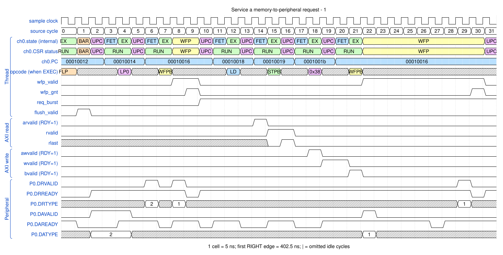

# Service a memory-to-peripheral request

<!-- reading-nav -->
[Guide index](README.md) · [Background](00_background.md) · [← Previous: 9. Reverse bytes inside endian-swap groups](09_endian.md) · [Next: 11. Service a peripheral-to-memory request →](11_p2m.md)
<!-- /reading-nav -->

## Purpose

Connect one peripheral request to a loaded burst and write-side acknowledgement.

## Starting conditions

P0 requests a burst. Sixteen memory bytes are written as two FIXED beats to peripheral address 0x40000000.

## Minimal sequence

The sequence below is an explanatory sketch. The recorded assembler may emit extra CCR updates or loop setup. The source-run name below identifies the reproducible simulation.

```text
DMAFLUSHP P0
DMAWFP P0, burst
DMALD
DMASTPB P0
DMAWMB
```

## Read the waveform

1. FLUSHP synchronizes the interface before the illustrated request. Its prior handshake is context, not another copy.
2. External DR accepts the request; WFP grants the channel and establishes request_type=burst.
3. DMALD obtains the memory bytes and DMASTPB writes the fixed peripheral address.
4. DA burst acknowledgement follows the peripheral-side write response, not just WLAST.

Group brackets separate the thread, shared storage and active interfaces. Inactive interfaces and uninformative constant rows are omitted. A constant needed to explain a stall or security decision stays visible. Pastel state colors distinguish execution, waiting and faults; equal payload values share a color across read/write rows. [WaveDrom conventions and color legend](00_conventions.md) define cell timing, data labels and snapshots.

### Waveform 1

[](../svg/10_m2p_1.svg)

[Open SVG at full size](../svg/10_m2p_1.svg) | [WaveDrom JSON](../wavejson/10_m2p_1.json)

Arm CSR labels: `EXEC` = Executing (`0x1`); `UPC` = Updating PC (`0x3`); `BAR` = At barrier (`0x5`); `WFP` = Waiting for peripheral (`0x7`).

Source: `direct_m2p`. Core/unit cycle snapshots cover the selected **382.5..542.5 ns** interval. The first cell's right sampling edge is **382.5 ns**.

| Exact VCD time (ns) | Milestone | Meaning |
|---:|---|---|
| 397.5 | P0 DA accepted | type=0 (single); measured on peripheral clock |
| 412.5 | P0 DR accepted | type=2 (flush); measured on peripheral clock |
| 422.5 | P0 DR accepted | type=1 (burst); measured on peripheral clock |
| 422.5 | WFP grant | 0x1 |
| 447.5 | AR accepted | ID=0; address=0x10000000; 2 beats x 8 B; INCR |
| 462.5 | RLAST accepted | RESP=0 |
| 472.5 | AW accepted | ID=0; address=0x40000000; 2 beats x 8 B; FIXED |
| 482.5 | WLAST accepted | WSTRB=0xff |
| 487.5 | B response accepted | RESP=0 |
| 497.5 | P0 DA accepted | type=0 (single); measured on peripheral clock |
| 537.5 | P0 DR accepted | type=1 (burst); measured on peripheral clock |
| 537.5 | WFP grant | 0x1 |

Full values for the short labels in this picture (matching D labels mean matching data):

| Label | Signal(s) | Full value |
|---|---|---|
| A1 | ch0.PC | `0001000c` |

Useful constant context: `arready=1 (no back-pressure)`; `awready=1 (no back-pressure)`; `wready=1 (no back-pressure)`.

## Result and rule to remember

Request acceptance, WFP grant, payload movement and DA acknowledgement are four distinct milestones.

## Design reference

TRM §§2.6.4-2.6.6; DMAWFP and DMASTP.

For source tests, reproduction commands and validation scope, see [Reproduction and validation](99_validation.md).

---

<!-- reading-nav -->
[Guide index](README.md) · [Background](00_background.md) · [← Previous: 9. Reverse bytes inside endian-swap groups](09_endian.md) · [Next: 11. Service a peripheral-to-memory request →](11_p2m.md)
<!-- /reading-nav -->
