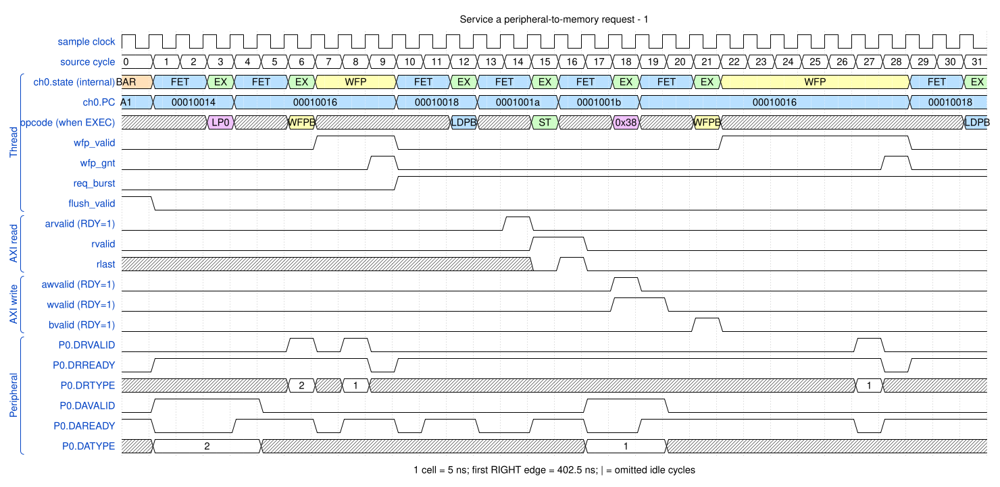

# Service a peripheral-to-memory request

<!-- reading-nav -->
[Guide index](README.md) · [Background](00_background.md) · [← Previous: 10. Service a memory-to-peripheral request](10_m2p.md) · [Next: 12. Select single or burst work and terminate on the final request →](12_request_types.md)
<!-- /reading-nav -->

## Purpose

See why a peripheral read acknowledgement can precede destination write completion.

## Starting conditions

Read two FIXED beats at 0x40000000, then write incrementing memory.

## Minimal sequence

The sequence below is an explanatory sketch. The recorded assembler may emit extra CCR updates or loop setup. The source-run name below identifies the reproducible simulation.

```text
DMAFLUSHP P0
DMAWFP P0, burst
DMALDPB P0
DMAST
DMAWMB
```

## Read the waveform

1. WFP waits for the peripheral request before the selected transfer instructions proceed.
2. DMALDPB reads the peripheral and requests DA acknowledgement when its final read completes.
3. That acknowledgement releases the peripheral side; it is not the whole DMA job's completion event.
4. The memory-side write and its B response can follow later. DMAWMB provides the later job-ordering point.

Group brackets separate the thread, shared storage and active interfaces. Inactive interfaces and uninformative constant rows are omitted. A constant needed to explain a stall or security decision stays visible. Pastel state colors distinguish execution, waiting and faults; equal payload values share a color across read/write rows. [WaveDrom conventions and color legend](00_conventions.md) define cell timing, data labels and snapshots.

### Waveform 1

[](../svg/11_p2m_1.svg)

[Open SVG at full size](../svg/11_p2m_1.svg) | [WaveDrom JSON](../wavejson/11_p2m_1.json)

Source: `direct_p2m`. Core/unit cycle snapshots cover the selected **402.5..562.5 ns** interval. The first cell's right sampling edge is **402.5 ns**.

| Exact VCD time (ns) | Milestone | Meaning |
|---:|---|---|
| 422.5 | P0 DA accepted | type=0 (single); measured on peripheral clock |
| 432.5 | P0 DR accepted | type=2 (flush); measured on peripheral clock |
| 442.5 | P0 DR accepted | type=1 (burst); measured on peripheral clock |
| 442.5 | WFP grant | 0x1 |
| 472.5 | AR accepted | ID=0; address=0x40000000; 2 beats x 8 B; FIXED |
| 482.5 | RLAST accepted | RESP=0 |
| 492.5 | AW accepted | ID=0; address=0x20000000; 2 beats x 8 B; INCR |
| 497.5 | P0 DA accepted | type=0 (single); measured on peripheral clock |
| 502.5 | WLAST accepted | WSTRB=0xff |
| 507.5 | B response accepted | RESP=0 |
| 537.5 | P0 DR accepted | type=1 (burst); measured on peripheral clock |
| 537.5 | WFP grant | 0x1 |

Useful constant context: `arready=1 (no back-pressure)`; `awready=1 (no back-pressure)`; `wready=1 (no back-pressure)`.

## Result and rule to remember

LDP acknowledges read completion; STP acknowledges write completion.

## Design reference

TRM §2.6.5; DMALDP, DMASTP.

For source tests, reproduction commands and validation scope, see [Reproduction and validation](99_validation.md).

---

<!-- reading-nav -->
[Guide index](README.md) · [Background](00_background.md) · [← Previous: 10. Service a memory-to-peripheral request](10_m2p.md) · [Next: 12. Select single or burst work and terminate on the final request →](12_request_types.md)
<!-- /reading-nav -->
