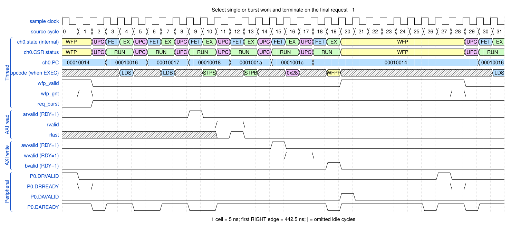
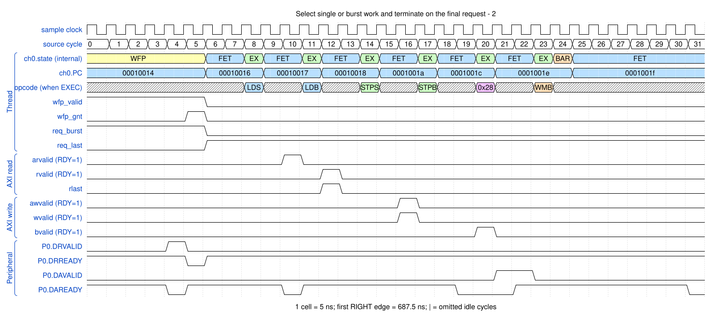

# Select single or burst work and terminate on the final request

<!-- reading-nav -->
[Guide index](README.md) · [Background](00_background.md) · [← Previous: 11. Service a peripheral-to-memory request](11_p2m.md) · [Next: 13. Synchronize a channel using a sticky event →](13_events.md)
<!-- /reading-nav -->


## Purpose

Explain conditional S/B instructions using the latched peripheral request flags.

## Starting conditions

CCR asks for two beats. DMAWFP periph copies request_type and DRLAST. One example services a burst and the other a final single request.

## Minimal sequence

The sequence below is an explanatory sketch. The recorded assembler may emit extra CCR updates or loop setup. The source-run name below identifies the reproducible simulation.

```text
loop:
  DMAWFP P0, periph
  DMALDS
  DMALDB
  DMASTPS P0
  DMASTPB P0
DMALPFE loop
DMAWMB
```

## Read the waveform

1. For a burst request, only the B instructions transfer the configured two beats.
2. For a single request, only the S instructions transfer and LEN is forced to zero, despite the CCR length.
3. Non-matching conditional opcodes act as NOPs; fetching them does not prove an AXI transfer occurred.
4. The final request sets req_last. After servicing it, the forever-loop end falls through.

Group brackets separate the thread, shared storage and active interfaces. Inactive interfaces and uninformative constant rows are omitted. A constant needed to explain a stall or security decision stays visible. Pastel state colors distinguish execution, waiting and faults; equal payload values share a color across read/write rows. [WaveDrom conventions and color legend](00_conventions.md) define cell timing, data labels and snapshots.

### Waveform 1

[](../svg/12_request_types_1.svg)

[Open SVG at full size](../svg/12_request_types_1.svg) | [WaveDrom JSON](../wavejson/12_request_types_1.json)

Source: `direct_periph_mixed`. Core/unit cycle snapshots cover the selected **442.5..602.5 ns** interval. The first cell's right sampling edge is **442.5 ns**.

| Exact VCD time (ns) | Milestone | Meaning |
|---:|---|---|
| 442.5 | P0 DR accepted | type=1 (burst); measured on peripheral clock |
| 442.5 | WFP grant | 0x1 |
| 487.5 | AR accepted | ID=0; address=0x10000000; 2 beats x 8 B; INCR |
| 502.5 | RLAST accepted | RESP=0 |
| 517.5 | AW accepted | ID=0; address=0x40000000; 2 beats x 8 B; FIXED |
| 522.5 | WLAST accepted | WSTRB=0xff |
| 527.5 | B response accepted | RESP=0 |
| 532.5 | P0 DA accepted | type=0 (single); measured on peripheral clock |
| 567.5 | P0 DR accepted | type=1 (burst); measured on peripheral clock |
| 567.5 | WFP grant | 0x1 |

Useful constant context: `arready=1 (no back-pressure)`; `awready=1 (no back-pressure)`; `wready=1 (no back-pressure)`.

### Waveform 2

[](../svg/12_request_types_2.svg)

[Open SVG at full size](../svg/12_request_types_2.svg) | [WaveDrom JSON](../wavejson/12_request_types_2.json)

Source: `direct_periph_mixed`. Core/unit cycle snapshots cover the selected **687.5..847.5 ns** interval. The first cell's right sampling edge is **687.5 ns**.

| Exact VCD time (ns) | Milestone | Meaning |
|---:|---|---|
| 707.5 | P0 DR accepted | type=0 (single); measured on peripheral clock |
| 707.5 | WFP grant | 0x1 |
| 737.5 | AR accepted | ID=0; address=0x10000020; 1 beats x 8 B; INCR |
| 747.5 | RLAST accepted | RESP=0 |
| 767.5 | AW accepted | ID=0; address=0x40000000; 1 beats x 8 B; FIXED |
| 767.5 | WLAST accepted | WSTRB=0xff |
| 787.5 | B response accepted | RESP=0 |
| 797.5 | P0 DA accepted | type=0 (single); measured on peripheral clock |

Useful constant context: `arready=1 (no back-pressure)`; `awready=1 (no back-pressure)`; `wready=1 (no back-pressure)`.

## Result and rule to remember

The peripheral controls both transfer form and, with DRLAST, the end of the request series.

## Design reference

TRM §2.6.4; conditional loads/stores and DMALPEND.

For source tests, reproduction commands and validation scope, see [Reproduction and validation](99_validation.md).

---

<!-- reading-nav -->
[Guide index](README.md) · [Background](00_background.md) · [← Previous: 11. Service a peripheral-to-memory request](11_p2m.md) · [Next: 13. Synchronize a channel using a sticky event →](13_events.md)
<!-- /reading-nav -->
