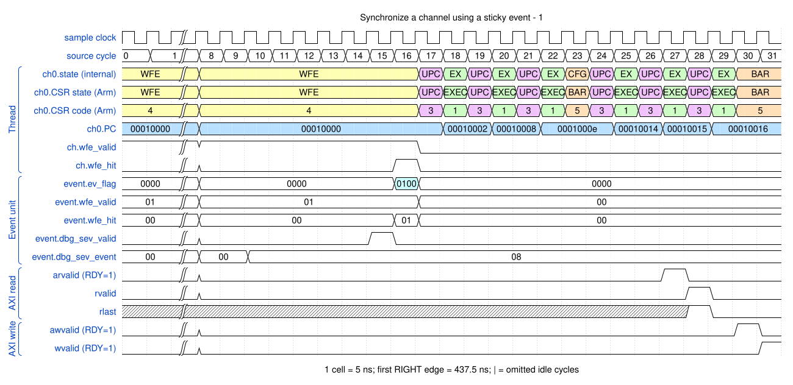
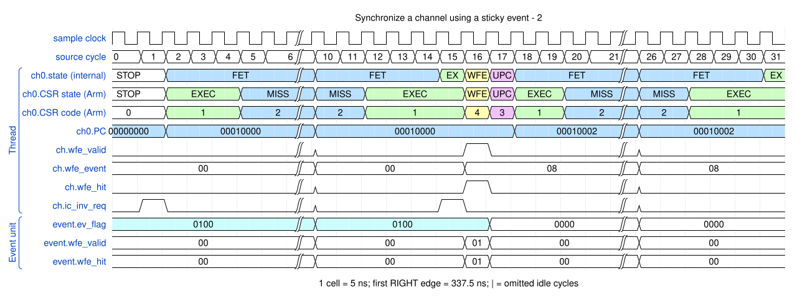

# Synchronize a channel using a sticky event

<!-- reading-nav -->
[Guide index](README.md) · [Background](00_background.md) · [← Previous: 12. Select single or burst work and terminate on the final request](12_request_types.md) · [Next: 14. Cancel an instruction-cache response safely →](14_cache.md)
<!-- /reading-nav -->

## Purpose

Compare a signal arriving after the wait with a signal already pending before the wait.

## Starting conditions

E8 is an event (INTEN[8]=0); E0 is a completion interrupt. The second program uses DMAWFE E8, invalid.

## Minimal sequence

The sequence below is an explanatory sketch. The recorded assembler may emit extra CCR updates or loop setup. The source-run name below identifies the reproducible simulation.

```text
DMAWFE E8[, invalid]
; perform the copy
DMAWMB
DMASEV E0
DMAEND
CPU or producer: DMASEV E8
```

## Read the waveform

1. A channel in WFE makes no progress past the wait until the matching event flag is available.
2. DMASEV sets the sticky flag; a matching waiter consumes it and resumes.
3. If SEV arrived earlier, the flag remains pending and the later WFE can consume it.
4. With invalid, the wake sequence also requests local instruction-cache maintenance. E0 later reports completion only because WMB precedes it.

Group brackets separate the thread, shared storage and active interfaces. Inactive interfaces and uninformative constant rows are omitted. A constant needed to explain a stall or security decision stays visible. Pastel state colors distinguish execution, waiting and faults; equal payload values share a color across read/write rows. [WaveDrom conventions and color legend](00_conventions.md) define cell timing, data labels and snapshots.

### Waveform 1

[](../svg/13_events_1.svg)

[Open SVG at full size](../svg/13_events_1.svg) | [WaveDrom JSON](../wavejson/13_events_1.json)

Source: `direct_wait_event`. Core/unit cycle snapshots cover the selected **437.5..597.5 ns** interval. The first cell's right sampling edge is **437.5 ns**.

| Exact VCD time (ns) | Milestone | Meaning |
|---:|---|---|
| 512.5 | WFE hit | 0x1 |
| 572.5 | AR accepted | ID=0; address=0x10000000; 1 beats x 8 B; INCR |
| 577.5 | RLAST accepted | RESP=0 |
| 587.5 | AW accepted | ID=0; address=0x20000000; 1 beats x 8 B; INCR |
| 592.5 | WLAST accepted | WSTRB=0xff |

Useful constant context: `arready=1 (no back-pressure)`; `awready=1 (no back-pressure)`; `wready=1 (no back-pressure)`.

### Waveform 2

[](../svg/13_events_2.svg)

[Open SVG at full size](../svg/13_events_2.svg) | [WaveDrom JSON](../wavejson/13_events_2.json)

Source: `direct_sticky_event`. Core/unit cycle snapshots cover the selected **337.5..497.5 ns** interval. The first cell's right sampling edge is **337.5 ns**.

| Exact VCD time (ns) | Milestone | Meaning |
|---:|---|---|
| 412.5 | WFE hit | 0x1 |

## Result and rule to remember

An event is a sticky synchronization flag, not a lost one-cycle pulse or an accumulating counting semaphore.

## Design reference

TRM DMAWFE, DMASEV; INTEN routing.

For source tests, reproduction commands and validation scope, see [Reproduction and validation](99_validation.md).

---

<!-- reading-nav -->
[Guide index](README.md) · [Background](00_background.md) · [← Previous: 12. Select single or burst work and terminate on the final request](12_request_types.md) · [Next: 14. Cancel an instruction-cache response safely →](14_cache.md)
<!-- /reading-nav -->
