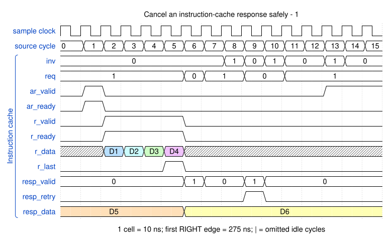

# Cancel an instruction-cache response safely

<!-- reading-nav -->
[Guide index](README.md) · [Background](00_background.md) · [← Previous: 13. Synchronize a channel using a sticky event](13_events.md) · [Next: 15. Kill a channel waiting on an event →](15_kill.md)
<!-- /reading-nav -->


## Purpose

Understand why invalidation returns retry rather than stale executable bytes.

## Starting conditions

The unchanged cache unit test invalidates a requesting context; the selected interval shows retry and a subsequent refill.

## Minimal sequence

The sequence below is an explanatory sketch. The recorded assembler may emit extra CCR updates or loop setup. The source-run name below identifies the reproducible simulation.

```text
Request program line
Invalidate the context before delivery
Drain an already issued bus transaction
Return retry, not a valid stale line
Fetch again for the live context
```

## Read the waveform

1. A cache request and any accepted external read have independent lifetimes.
2. Invalidation prevents the old line from being delivered/committed for the invalidated context.
3. resp_retry tells the fetch unit to request fresh bytes; it is different from resp_err.
4. The original unit test checks thread/NS tagging and cancellation. Its clock is 10 ns, not the top-level 5 ns clock.

Group brackets separate the thread, shared storage and active interfaces. Inactive interfaces and uninformative constant rows are omitted. A constant needed to explain a stall or security decision stays visible. Pastel state colors distinguish execution, waiting and faults; equal payload values share a color across read/write rows. [WaveDrom conventions and color legend](00_conventions.md) define cell timing, data labels and snapshots.

### Waveform 1

[](../svg/14_cache_1.svg)

[Open SVG at full size](../svg/14_cache_1.svg) | [WaveDrom JSON](../wavejson/14_cache_1.json)

Source: `dma_icache_tb`. Core/unit cycle snapshots cover the selected **275..435 ns** interval. The first cell's right sampling edge is **275 ns**.

| Exact VCD time (ns) | Milestone | Meaning |
|---:|---|---|
| 275 | ar_valid | 0x1 |
| 316 | r_last | 0x1 |
| 325 | resp_valid | 0x1 |
| 346 | inv | 0x1 |
| 355 | resp_retry | 0x1 |
| 355 | resp_valid | 0x1 |
| 366 | inv | 0x1 |
| 395 | ar_valid | 0x1 |
| 396 | inv | 0x1 |

Full values for the short labels in this picture (matching D labels mean matching data):

| Label | Signal(s) | Full value |
|---|---|---|
| D1 | r_data | `0000000000003300` |
| D2 | r_data | `0000000000003301` |
| D3 | r_data | `0000000000003302` |
| D4 | r_data | `0000000000003303` |
| D5 | resp_data | `0000000000002203000000000000220200000000000022010000000000002200` |
| D6 | resp_data | `0000000000003303000000000000330200000000000033010000000000003300` |

Useful constant context: `ar_len=03`.

## Result and rule to remember

Invalidation cancels the executable result, not an AXI obligation already accepted by the bus.

## Design reference

TRM DMAWFE invalid; workspace cache/fetch cancellation mechanism.

For source tests, reproduction commands and validation scope, see [Reproduction and validation](99_validation.md).

---

<!-- reading-nav -->
[Guide index](README.md) · [Background](00_background.md) · [← Previous: 13. Synchronize a channel using a sticky event](13_events.md) · [Next: 15. Kill a channel waiting on an event →](15_kill.md)
<!-- /reading-nav -->
