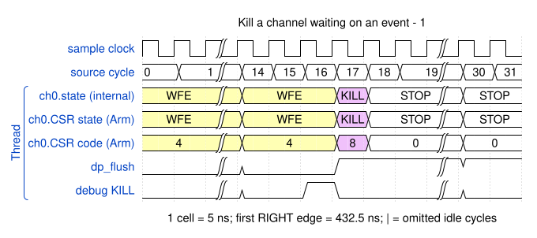

# Kill a channel waiting on an event

<!-- reading-nav -->
[Guide index](README.md) · [Background](00_background.md) · [← Previous: 14. Cancel an instruction-cache response safely](14_cache.md) · [Next: 16. Diagnose a precise program fault and an imprecise bus fault →](16_faults.md)
<!-- /reading-nav -->

## Purpose

Distinguish cancellation from successful program completion.

## Starting conditions

Channel 0 waits on E8. Software injects channel-context DMAKILL.

## Minimal sequence

The sequence below is an explanatory sketch. The recorded assembler may emit extra CCR updates or loop setup. The source-run name below identifies the reproducible simulation.

```text
Channel: DMAWFE E8
CPU debug: DMAKILL C0
CPU: wait CSR == Stopped
```

## Read the waveform

1. The channel remains in WFE with no event grant.
2. DMAKILL switches it into cleanup, flushes queued channel work and waits for outstanding obligations.
3. The channel reaches Stopped. No E0 successful-copy notification is expected.
4. A kill during active traffic can leave partial memory updates; cancellation is not rollback.

Group brackets separate the thread, shared storage and active interfaces. Inactive interfaces and uninformative constant rows are omitted. A constant needed to explain a stall or security decision stays visible. Pastel state colors distinguish execution, waiting and faults; equal payload values share a color across read/write rows. [WaveDrom conventions and color legend](00_conventions.md) define cell timing, data labels and snapshots.

### Waveform 1

[](../svg/15_kill_1.svg)

[Open SVG at full size](../svg/15_kill_1.svg) | [WaveDrom JSON](../wavejson/15_kill_1.json)

Arm CSR labels: `STOP` = Stopped (`0x0`); `WFE` = Waiting for event (`0x4`); `KILL` = Killing (`0x8`).

Source: `direct_kill_wait`. Core/unit cycle snapshots cover the selected **428.5..588.5 ns** interval. The first cell's right sampling edge is **432.5 ns**.

| Exact VCD time (ns) | Milestone | Meaning |
|---:|---|---|

## Result and rule to remember

Stopped after KILL means cleanup finished, not that the requested copy succeeded.

## Design reference

TRM DMAKILL and abort handling.

For source tests, reproduction commands and validation scope, see [Reproduction and validation](99_validation.md).

---

<!-- reading-nav -->
[Guide index](README.md) · [Background](00_background.md) · [← Previous: 14. Cancel an instruction-cache response safely](14_cache.md) · [Next: 16. Diagnose a precise program fault and an imprecise bus fault →](16_faults.md)
<!-- /reading-nav -->
