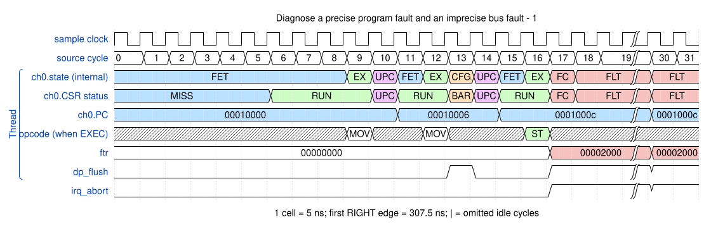
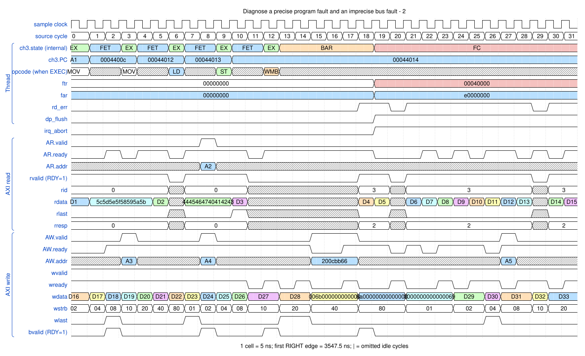

# Diagnose a precise program fault and an imprecise bus fault

<!-- reading-nav -->
[Guide index](README.md) · [Background](00_background.md) · [← Previous: 15. Kill a channel waiting on an event](15_kill.md) · [Next: 17. Share the bus and MFIFO between channels →](17_sharing.md)
<!-- /reading-nav -->


## Purpose

Use FTR, CPC and FAR for the right purpose instead of treating every abort PC as precise.

## Starting conditions

First issue DMAST without loaded bytes. Then inspect a data-read SLVERR from the original fault test.

## Minimal sequence

The sequence below is an explanatory sketch. The recorded assembler may emit extra CCR updates or loop setup. The source-run name below identifies the reproducible simulation.

```text
; precise example
DMAMOV DAR, 0x20000000
DMAMOV CCR, one_8byte_beat
DMAST ; no preceding LD
; recovery: read FTR/CPC, KILL, repair/restart
```

## Read the waveform

1. The unavailable-data store sets FTR[13] and keeps CPC at offset 0x0c; the direct test checks both exactly.
2. A non-OKAY data response sets data_read_err or data_write_err. Those bus aborts are imprecise.
3. For an imprecise abort, the current CPC may point beyond the instruction that issued the request. FAR is this workspace's separate first-error bus address.
4. Save diagnosis before KILL. Repair the cause, then start a new checked copy; do not treat restart as a continuation of the failed transfer.

Group brackets separate the thread, shared storage and active interfaces. Inactive interfaces and uninformative constant rows are omitted. A constant needed to explain a stall or security decision stays visible. Pastel state colors distinguish execution, waiting and faults; equal payload values share a color across read/write rows. [WaveDrom conventions and color legend](00_conventions.md) define cell timing, data labels and snapshots.

### Waveform 1

[](../svg/16_faults_1.svg)

[Open SVG at full size](../svg/16_faults_1.svg) | [WaveDrom JSON](../wavejson/16_faults_1.json)

Source: `direct_underflow`. Core/unit cycle snapshots cover the selected **302.5..462.5 ns** interval. The first cell's right sampling edge is **302.5 ns**.

| Exact VCD time (ns) | Milestone | Meaning |
|---:|---|---|
| 382.5 | FTR | 0x2000 |

### Waveform 2

[](../svg/16_faults_2.svg)

[Open SVG at full size](../svg/16_faults_2.svg) | [WaveDrom JSON](../wavejson/16_faults_2.json)

Source: `dma_fault_test_sync`. Core/unit cycle snapshots cover the selected **3547.5..3707.5 ns** interval. The first cell's right sampling edge is **3547.5 ns**.

| Exact VCD time (ns) | Milestone | Meaning |
|---:|---|---|
| 3557.5 | B response accepted | RESP=0 |
| 3557.5 | WLAST accepted | WSTRB=0x08 |
| 3562.5 | AW accepted | ID=0; address=0x200cbb5c; 5 beats x 1 B; INCR |
| 3582.5 | WLAST accepted | WSTRB=0x01 |
| 3587.5 | AR accepted | ID=3; address=0xe0000000; 16 beats x 8 B; INCR |
| 3587.5 | AW accepted | ID=0; address=0x200cbb61; 5 beats x 1 B; INCR |
| 3587.5 | B response accepted | RESP=0 |
| 3597.5 | RLAST accepted | RESP=0 |
| 3607.5 | B response accepted | RESP=0 |
| 3617.5 | WLAST accepted | WSTRB=0x20 |
| 3632.5 | AW accepted | ID=0; address=0x200cbb66; 5 beats x 1 B; INCR |
| 3637.5 | FTR | 0x40000 |
| 3682.5 | AW accepted | ID=0; address=0x200cbb6b; 5 beats x 1 B; INCR |

Full values for the short labels in this picture (matching D labels mean matching data):

| Label | Signal(s) | Full value |
|---|---|---|
| A1 | ch3.PC | `00044006` |
| A2 | AR.addr | `e0000000` |
| A3 | AW.addr | `200cbb5c` |
| A4 | AW.addr | `200cbb61` |
| A5 | AW.addr | `200cbb6b` |
| D1 | rdata | `5455565750515253` |
| D2 | rdata | `4445464740414243` |
| D3 | rdata | `4c4d4e4f48494a4b` |
| D4 | rdata | `bdbcbfbeb9b8bbba` |
| D5 | rdata | `b5b4b7b6b1b0b3b2` |
| D6 | rdata | `adacafaea9a8abaa` |
| D7 | rdata | `a5a4a7a6a1a0a3a2` |
| D8 | rdata | `9d9c9f9e99989b9a` |
| D9 | rdata | `9594979691909392` |
| D10 | rdata | `8d8c8f8e89888b8a` |
| D11 | rdata | `8584878681808382` |
| D12 | rdata | `fdfcfffef9f8fbfa` |
| D13 | rdata | `f5f4f7f6f1f0f3f2` |
| D14 | rdata | `edecefeee9e8ebea` |
| D15 | rdata | `e5e4e7e6e1e0e3e2` |
| D16 | wdata | `0000000000007800` |
| D17 | wdata | `00000000007f0000` |
| D18 | wdata | `000000007e000000` |
| D19 | wdata | `0000007d00000000` |
| D20 | wdata | `00007c0000000000` |
| D21 | wdata | `0063000000000000` |
| D22 | wdata | `6200000000000000` |
| D23 | wdata | `0000000000000061` |
| D24 | wdata | `0000000000006000` |
| D25 | wdata | `0000000000670000` |
| D26 | wdata | `0000000066000000` |
| D27 | wdata | `0000006500000000` |
| D28 | wdata | `0000640000000000` |
| D29 | wdata | `0000000000006800` |
| D30 | wdata | `00000000006f0000` |
| D31 | wdata | `000000006e000000` |
| D32 | wdata | `0000006d00000000` |
| D33 | wdata | `00006c0000000000` |

Useful constant context: `AR.len=0f`; `AW.len=04`; `rready=1 (no back-pressure)`; `bready=1 (no back-pressure)`.

## Result and rule to remember

Fault cause, program location and bus-error address are related evidence, but they are not interchangeable.

## Design reference

TRM §2.8 and Table 3-16; FAR is a workspace extension.

For source tests, reproduction commands and validation scope, see [Reproduction and validation](99_validation.md).

---

<!-- reading-nav -->
[Guide index](README.md) · [Background](00_background.md) · [← Previous: 15. Kill a channel waiting on an event](15_kill.md) · [Next: 17. Share the bus and MFIFO between channels →](17_sharing.md)
<!-- /reading-nav -->
