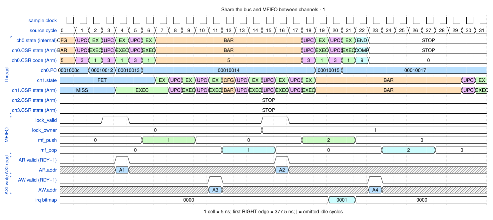
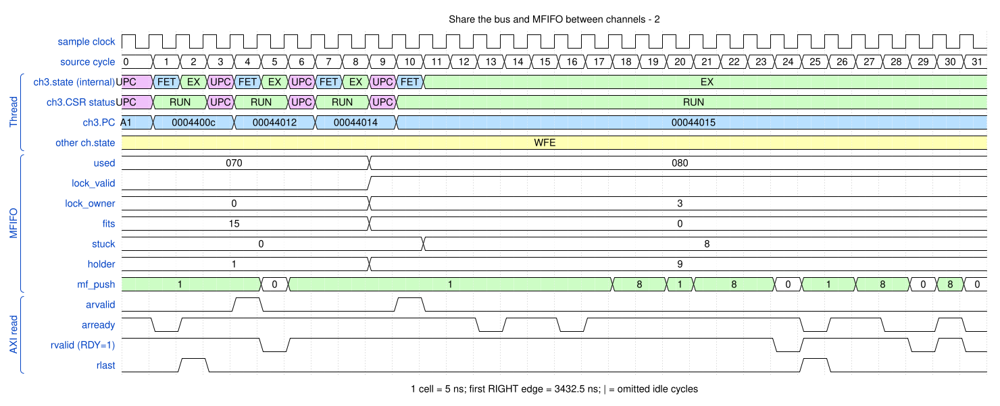

# Share the bus and MFIFO between channels

<!-- reading-nav -->
[Guide index](README.md) · [Background](00_background.md) · [← Previous: 16. Diagnose a precise program fault and an imprecise bus fault](16_faults.md) · [Next: 18. Execute a non-secure channel program →](18_security.md)
<!-- /reading-nav -->

## Purpose

Show interleaved channel traffic and admission stalled by reserved shared storage.

## Starting conditions

First run two 32-byte copies. Then inspect the original shared-pool test while another load waits for space.

## Minimal sequence

The sequence below is an explanatory sketch. The recorded assembler may emit extra CCR updates or loop setup. The source-run name below identifies the reproducible simulation.

```text
C0: LD ; ST ; WMB ; SEV E0
C1: LD ; ST ; WMB ; SEV E1
; shared-pool example
Holder: repeated LD ... wait ... ST
Waiter: LD waits for admission/space
```

## Read the waveform

1. IDs distinguish channel data streams while shared arbitration interleaves requests.
2. The MFIFO keeps separate per-channel byte streams; one channel cannot consume another channel's bytes.
3. Read admission reserves storage for responses still in flight. used counts lines, not just returned payload bytes.
4. A blocked LD can be normal back-pressure. Load-lock and a valid static/dynamic resource budget prevent stranded load groups; the full deadlock matrix belongs in verification reference.

Group brackets separate the thread, shared storage and active interfaces. Inactive interfaces and uninformative constant rows are omitted. A constant needed to explain a stall or security decision stays visible. Pastel state colors distinguish execution, waiting and faults; equal payload values share a color across read/write rows. [WaveDrom conventions and color legend](00_conventions.md) define cell timing, data labels and snapshots.

### Waveform 1

[](../svg/17_sharing_1.svg)

[Open SVG at full size](../svg/17_sharing_1.svg) | [WaveDrom JSON](../wavejson/17_sharing_1.json)

Source: `direct_two_channels`. Core/unit cycle snapshots cover the selected **392.5..552.5 ns** interval. The first cell's right sampling edge is **392.5 ns**.

| Exact VCD time (ns) | Milestone | Meaning |
|---:|---|---|
| 412.5 | AR accepted | ID=0; address=0x10000000; 4 beats x 8 B; INCR |
| 432.5 | RLAST accepted | RESP=0 |
| 442.5 | AW accepted | ID=0; address=0x20000000; 4 beats x 8 B; INCR |
| 462.5 | WLAST accepted | WSTRB=0xff |
| 467.5 | B response accepted | RESP=0 |
| 472.5 | AR accepted | ID=1; address=0x11000000; 4 beats x 8 B; INCR |
| 487.5 | IRQ bitmap | 0x1 |
| 492.5 | RLAST accepted | RESP=0 |
| 502.5 | AW accepted | ID=1; address=0x21000000; 4 beats x 8 B; INCR |
| 522.5 | WLAST accepted | WSTRB=0xff |
| 527.5 | B response accepted | RESP=0 |
| 547.5 | IRQ bitmap | 0x2 |

Full values for the short labels in this picture (matching D labels mean matching data):

| Label | Signal(s) | Full value |
|---|---|---|
| A1 | ch0.PC | `0001000c` |
| A2 | AR.addr | `10000000` |
| A3 | AR.addr | `11000000` |
| A4 | AW.addr | `20000000` |
| A5 | AW.addr | `21000000` |

Useful constant context: `AR.ready=1 (no back-pressure)`; `AR.len=03`; `AW.ready=1 (no back-pressure)`; `AW.len=03`.

### Waveform 2

[](../svg/17_sharing_2.svg)

[Open SVG at full size](../svg/17_sharing_2.svg) | [WaveDrom JSON](../wavejson/17_sharing_2.json)

Source: `dma_mfifo_share_test_sync`. Core/unit cycle snapshots cover the selected **3432.5..3592.5 ns** interval. The first cell's right sampling edge is **3432.5 ns**.

| Exact VCD time (ns) | Milestone | Meaning |
|---:|---|---|
| 3442.5 | RLAST accepted | RESP=0 |
| 3452.5 | AR accepted | ID=0; address=0x10004300; 16 beats x 8 B; INCR |
| 3482.5 | AR accepted | ID=3; address=0x13004000; 16 beats x 8 B; INCR |
| 3557.5 | RLAST accepted | RESP=0 |

Full values for the short labels in this picture (matching D labels mean matching data):

| Label | Signal(s) | Full value |
|---|---|---|
| A1 | ch3.PC | `00044006` |

## Result and rule to remember

Shared resources allow concurrency, but each program set must fit the MFIFO resource contract.

## Design reference

TRM §2.11.4 and Appendix B.

For source tests, reproduction commands and validation scope, see [Reproduction and validation](99_validation.md).

---

<!-- reading-nav -->
[Guide index](README.md) · [Background](00_background.md) · [← Previous: 16. Diagnose a precise program fault and an imprecise bus fault](16_faults.md) · [Next: 18. Execute a non-secure channel program →](18_security.md)
<!-- /reading-nav -->
