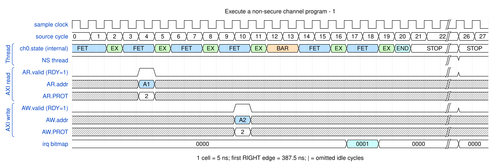

# Execute a non-secure channel program

<!-- reading-nav -->
[Guide index](README.md) · [Background](00_background.md) · [← Previous: 17. Share the bus and MFIFO between channels](17_sharing.md) · [Next: 19. Pass a peripheral request across unrelated clocks →](19_cdc.md)
<!-- /reading-nav -->


## Purpose

Separate thread NS state from the AXI protection attributes requested by CCR.

## Starting conditions

DMAGO launches an NS channel. CCR source/destination PROT[1] are set, and the selected event is permitted for NS use.

## Minimal sequence

The sequence below is an explanatory sketch. The recorded assembler may emit extra CCR updates or loop setup. The source-run name below identifies the reproducible simulation.

```text
DMAGO C0, program_address, ns
Channel: DMAMOV CCR, nonsecure_source_and_destination
DMALD
DMAST
DMAWMB
DMASEV E0
```

## Read the waveform

1. DMAGO selects the channel execution security state.
2. CCR independently selects ARPROT/AWPROT. Their NS bit must agree with what the thread is permitted to request.
3. Constant NS/PROT values are retained because they are the purpose of this operation, rather than dismissed as unchanging noise.
4. An NS channel asking for a secure data access faults; secure-event/peripheral permission checks are separate.

Group brackets separate the thread, shared storage and active interfaces. Inactive interfaces and uninformative constant rows are omitted. A constant needed to explain a stall or security decision stays visible. Pastel state colors distinguish execution, waiting and faults; equal payload values share a color across read/write rows. [WaveDrom conventions and color legend](00_conventions.md) define cell timing, data labels and snapshots.

### Waveform 1

[](../svg/18_security_1.svg)

[Open SVG at full size](../svg/18_security_1.svg) | [WaveDrom JSON](../wavejson/18_security_1.json)

Source: `direct_nonsecure`. Core/unit cycle snapshots cover the selected **387.5..527.5 ns** interval. The first cell's right sampling edge is **387.5 ns**.

| Exact VCD time (ns) | Milestone | Meaning |
|---:|---|---|
| 407.5 | AR accepted | ID=0; address=0x10000000; 1 beats x 8 B; INCR |
| 417.5 | RLAST accepted | RESP=0 |
| 437.5 | AW accepted | ID=0; address=0x20000000; 1 beats x 8 B; INCR |
| 437.5 | WLAST accepted | WSTRB=0xff |
| 447.5 | B response accepted | RESP=0 |
| 467.5 | IRQ bitmap | 0x1 |

Full values for the short labels in this picture (matching D labels mean matching data):

| Label | Signal(s) | Full value |
|---|---|---|
| A1 | AR.addr | `10000000` |
| A2 | AW.addr | `20000000` |

Useful constant context: `AR.ready=1 (no back-pressure)`; `AW.ready=1 (no back-pressure)`.

## Result and rule to remember

Launching through the secure APB port can legitimately start an NS channel with NS data accesses.

## Design reference

TRM security state, CCR protection fields and CR3/CR4.

For source tests, reproduction commands and validation scope, see [Reproduction and validation](99_validation.md).

---

<!-- reading-nav -->
[Guide index](README.md) · [Background](00_background.md) · [← Previous: 17. Share the bus and MFIFO between channels](17_sharing.md) · [Next: 19. Pass a peripheral request across unrelated clocks →](19_cdc.md)
<!-- /reading-nav -->
