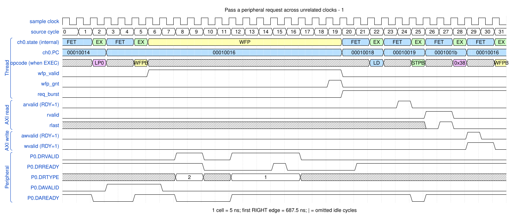

# Pass a peripheral request across unrelated clocks

<!-- reading-nav -->
[Guide index](README.md) · [Background](00_background.md) · [← Previous: 18. Execute a non-secure channel program](18_security.md) · [Next: 20. Accept sleep and wake the DMA for an APB access →](20_lowpower.md)
<!-- /reading-nav -->

## Purpose

Follow external request acceptance to the later core-side WFP grant.

## Starting conditions

Use the same small M2P job with asynchronous APB/peripheral bridges enabled.

## Minimal sequence

The sequence below is an explanatory sketch. The recorded assembler may emit extra CCR updates or loop setup. The source-run name below identifies the reproducible simulation.

```text
Peripheral clock: DRVALID && DRREADY accepts the request
Bridge: transfer the request context
Core clock: WFP grant resumes the channel
Core: LD ; STP
Bridge: return DA acknowledgement
```

## Read the waveform

1. DR/DA values in the WaveDrom are snapshots on the stated core sampling grid, not a sub-cycle model of each peripheral clock.
2. The exact peripheral handshake time is measured on that peripheral's clock and listed below the figure.
3. The core-side WFP grant appears after the crossing. Request fields remain associated through the bridge.
4. Compare order and captured context; the relative clock phase prevents a universal fixed nanosecond CDC latency.

Group brackets separate the thread, shared storage and active interfaces. Inactive interfaces and uninformative constant rows are omitted. A constant needed to explain a stall or security decision stays visible. Pastel state colors distinguish execution, waiting and faults; equal payload values share a color across read/write rows. [WaveDrom conventions and color legend](00_conventions.md) define cell timing, data labels and snapshots.

### Waveform 1

[](../svg/19_cdc_1.svg)

[Open SVG at full size](../svg/19_cdc_1.svg) | [WaveDrom JSON](../wavejson/19_cdc_1.json)

Source: `direct_m2p_async`. Core/unit cycle snapshots cover the selected **687.5..847.5 ns** interval. The first cell's right sampling edge is **687.5 ns**.

| Exact VCD time (ns) | Milestone | Meaning |
|---:|---|---|
| 717.5 | P0 DA accepted | type=2 (flush); measured on peripheral clock |
| 733.9 | P0 DR accepted | type=2 (flush); measured on peripheral clock |
| 766.7 | P0 DR accepted | type=1 (burst); measured on peripheral clock |
| 777.5 | WFP grant | 0x1 |
| 802.5 | AR accepted | ID=0; address=0x10000000; 2 beats x 8 B; INCR |
| 822.5 | RLAST accepted | RESP=0 |
| 832.5 | AW accepted | ID=0; address=0x40000000; 2 beats x 8 B; FIXED |
| 842.5 | WLAST accepted | WSTRB=0xff |

Full values for the short labels in this picture (matching D labels mean matching data):

| Label | Signal(s) | Full value |
|---|---|---|
| A1 | ch0.PC | `00010014` |

Useful constant context: `arready=1 (no back-pressure)`; `awready=1 (no back-pressure)`; `wready=1 (no back-pressure)`.

## Result and rule to remember

A CDC bridge preserves the request/response relationship; waveform simulation does not establish analog metastability safety.

## Design reference

Workspace CDC integration; TRM peripheral handshake contract.

For source tests, reproduction commands and validation scope, see [Reproduction and validation](99_validation.md).

---

<!-- reading-nav -->
[Guide index](README.md) · [Background](00_background.md) · [← Previous: 18. Execute a non-secure channel program](18_security.md) · [Next: 20. Accept sleep and wake the DMA for an APB access →](20_lowpower.md)
<!-- /reading-nav -->
