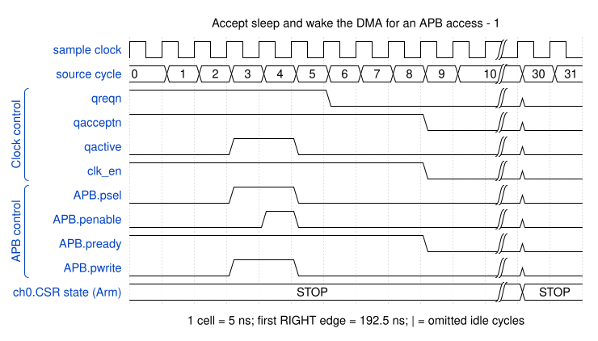
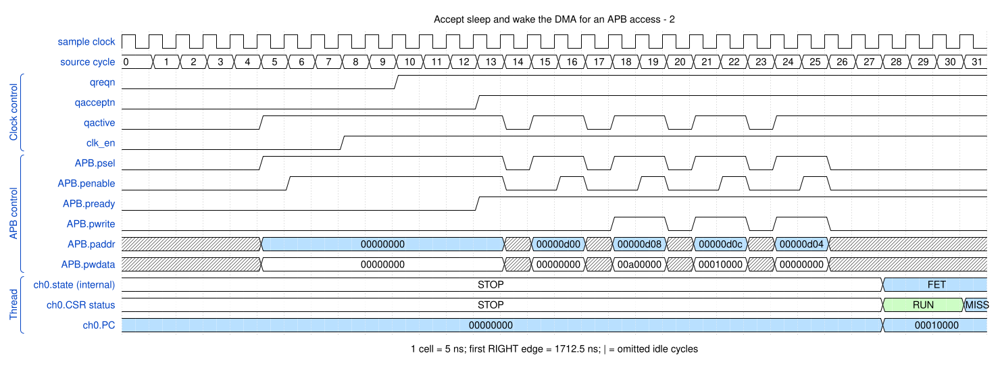

# Accept sleep and wake the DMA for an APB access

<!-- reading-nav -->
[Guide index](README.md) · [Background](00_background.md) · [← Previous: 19. Pass a peripheral request across unrelated clocks](19_cdc.md) · [Next: 21. Distinguish execution, PC calculation and a real cache refill →](21_thread_phases.md)
<!-- /reading-nav -->

## Purpose

Separate quiescence acceptance, actual clock gating and later wake-up.

## Starting conditions

The original low-power test requests sleep while idle, gates the DUT clock branch and restores it when work arrives.

## Minimal sequence

The sequence below is an explanatory sketch. The recorded assembler may emit extra CCR updates or loop setup. The source-run name below identifies the reproducible simulation.

```text
Clock controller: QREQn <- 0
Wait QACCEPTn == 0
Gate DUT clock
On QACTIVE / APB work: restore clock
QREQn <- 1
Wait QACCEPTn == 1
```

## Read the waveform

1. Synchronized QREQn requests quiescence; QACCEPTn=0 confirms it is safe to gate the DUT branch.
2. The source ACLK keeps running while the DUT branch is gated. Clock gating is an external-controller action after acceptance.
3. An APB request contributes to QACTIVE so the controller can restore the clock and release QREQn.
4. Busy work can instead cause QDENY. The original regression checks denial; this operation shows the idle accept/wake path.

Group brackets separate the thread, shared storage and active interfaces. Inactive interfaces and uninformative constant rows are omitted. A constant needed to explain a stall or security decision stays visible. Pastel state colors distinguish execution, waiting and faults; equal payload values share a color across read/write rows. [WaveDrom conventions and color legend](00_conventions.md) define cell timing, data labels and snapshots.

### Waveform 1

[](../svg/20_lowpower_1.svg)

[Open SVG at full size](../svg/20_lowpower_1.svg) | [WaveDrom JSON](../wavejson/20_lowpower_1.json)

Arm CSR labels: `STOP` = Stopped (`0x0`).

Source: `dma_lowpower_test_sync`. Core/unit cycle snapshots cover the selected **192.5..352.5 ns** interval. The first cell's right sampling edge is **192.5 ns**.

| Exact VCD time (ns) | Milestone | Meaning |
|---:|---|---|

### Waveform 2

[](../svg/20_lowpower_2.svg)

[Open SVG at full size](../svg/20_lowpower_2.svg) | [WaveDrom JSON](../wavejson/20_lowpower_2.json)

Arm CSR labels: `STOP` = Stopped (`0x0`); `EXEC` = Executing (`0x1`); `MISS` = Cache miss (`0x2`).

Source: `dma_lowpower_test_sync`. Core/unit cycle snapshots cover the selected **1712.5..1872.5 ns** interval. The first cell's right sampling edge is **1712.5 ns**.

| Exact VCD time (ns) | Milestone | Meaning |
|---:|---|---|

## Result and rule to remember

Clock quiescence is not a channel completion or a power-domain retention protocol. Q-Channel is a workspace extension.

## Design reference

Workspace dma_qchannel and top-level QACTIVE integration.

For source tests, reproduction commands and validation scope, see [Reproduction and validation](99_validation.md).

---

<!-- reading-nav -->
[Guide index](README.md) · [Background](00_background.md) · [← Previous: 19. Pass a peripheral request across unrelated clocks](19_cdc.md) · [Next: 21. Distinguish execution, PC calculation and a real cache refill →](21_thread_phases.md)
<!-- /reading-nav -->
