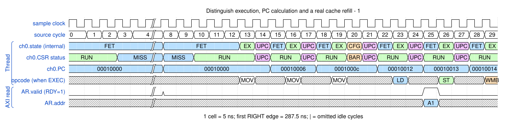
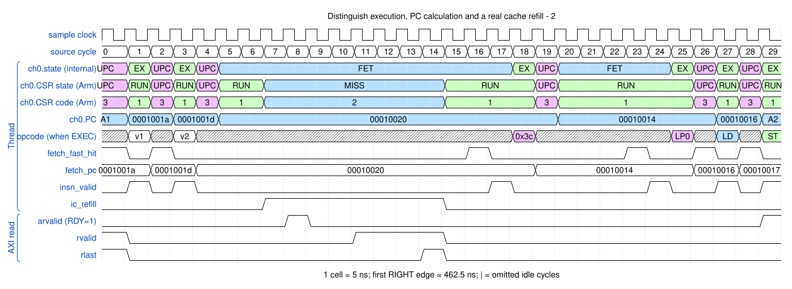

# Distinguish execution, PC calculation and a real cache refill

<!-- reading-nav -->
[Guide index](README.md) · [Background](00_background.md) · [← Previous: 20. Accept sleep and wake the DMA for an APB access](20_lowpower.md) · [Next: 22. Drain an implicit barrier before changing the transfer stream →](22_reconfiguration.md)
<!-- /reading-nav -->

## Purpose

Read internal phase and architectural CSR together instead of treating all fetch activity as Cache miss.

## Starting conditions

Compare the newly recorded short copy with a loop program whose next instruction needs front-end fetch work.

## Minimal sequence

The sequence below is an explanatory sketch. The recorded assembler may emit extra CCR updates or loop setup. The source-run name below identifies the reproducible simulation.

```text
Cold path: DMAGO -> FETCH/MISS -> EXEC
Buffered path: EXEC -> UPDATING_PC -> EXEC
Wait path: UPDATING_PC -> FETCH -> EXEC
```

## Read the waveform

1. The CSR row reports MISS only for a real per-thread shared-cache refill. FET alone does not imply MISS.
2. Instruction effects occur in EX. UPC calculates and commits the next CPC without reissuing the instruction.
3. At UPC with fetch_fast_hit=1, the next edge commits CPC and registers the instruction while entering EX directly. With fast_hit=0 the channel enters FET until instruction delivery. CSR remains UPC=3, Executing=1 or Cache miss=2; no new software status is introduced.

Group brackets separate the thread, shared storage and active interfaces. Inactive interfaces and uninformative constant rows are omitted. A constant needed to explain a stall or security decision stays visible. Pastel state colors distinguish execution, waiting and faults; equal payload values share a color across read/write rows. [WaveDrom conventions and color legend](00_conventions.md) define cell timing, data labels and snapshots.

### Waveform 1

[](../svg/21_thread_phases_1.svg)

[Open SVG at full size](../svg/21_thread_phases_1.svg) | [WaveDrom JSON](../wavejson/21_thread_phases_1.json)

Source: `direct_copy32`. Core/unit cycle snapshots cover the selected **342.5..492.5 ns** interval. The first cell's right sampling edge is **342.5 ns**.

| Exact VCD time (ns) | Milestone | Meaning |
|---:|---|---|
| 397.5 | AR accepted | ID=0; address=0x10000000; 4 beats x 8 B; INCR |
| 422.5 | RLAST accepted | RESP=0 |
| 432.5 | AW accepted | ID=0; address=0x20000000; 4 beats x 8 B; INCR |
| 452.5 | WLAST accepted | WSTRB=0xff |
| 457.5 | B response accepted | RESP=0 |
| 472.5 | IRQ bitmap | 0x1 |

Useful constant context: `arready=1 (no back-pressure)`.

### Waveform 2

[](../svg/21_thread_phases_2.svg)

[Open SVG at full size](../svg/21_thread_phases_2.svg) | [WaveDrom JSON](../wavejson/21_thread_phases_2.json)

Source: `direct_loop2d`. Core/unit cycle snapshots cover the selected **462.5..612.5 ns** interval. The first cell's right sampling edge is **462.5 ns**.

| Exact VCD time (ns) | Milestone | Meaning |
|---:|---|---|
| 462.5 | RLAST accepted | RESP=0 |
| 472.5 | AW accepted | ID=0; address=0x20000010; 2 beats x 8 B; INCR |
| 482.5 | WLAST accepted | WSTRB=0xff |
| 487.5 | B response accepted | RESP=0 |
| 607.5 | AR accepted | ID=0; address=0x10000030; 2 beats x 8 B; INCR |

Full values for the short labels in this picture (matching D labels mean matching data):

| Label | Signal(s) | Full value |
|---|---|---|
| A1 | ch0.PC | `00010018` |
| A2 | ch0.PC | `00010017` |
| v1 | opcode (when EXEC) | `ADDH-S` |
| v2 | opcode (when EXEC) | `ADDH-D` |

Useful constant context: `arready=1 (no back-pressure)`.

## Result and rule to remember

Internal enum 10 means UPC; architectural status 3 means Updating PC. The two encodings must be decoded separately.

## Design reference

TRM sections 2.3.3-2.3.4; current channel and cache refill-pending logic.

For source tests, reproduction commands and validation scope, see [Reproduction and validation](99_validation.md).

---

<!-- reading-nav -->
[Guide index](README.md) · [Background](00_background.md) · [← Previous: 20. Accept sleep and wake the DMA for an APB access](20_lowpower.md) · [Next: 22. Drain an implicit barrier before changing the transfer stream →](22_reconfiguration.md)
<!-- /reading-nav -->
