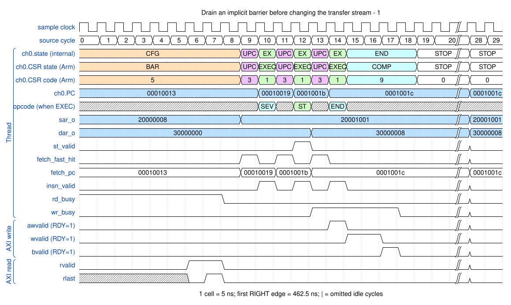
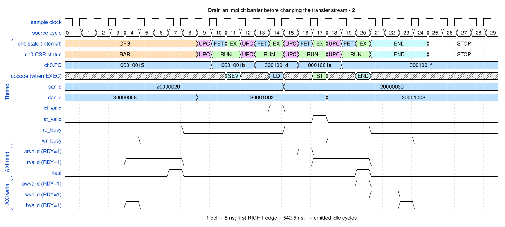

# Drain an implicit barrier before changing the transfer stream

<!-- reading-nav -->
[Guide index](README.md) · [Background](00_background.md) · [← Previous: 21. Distinguish execution, PC calculation and a real cache refill](21_thread_phases.md) · [Next: 23. Swap 128-bit groups across narrower AXI beats →](23_swap128.md)
<!-- /reading-nav -->

## Purpose

Compare source reconfiguration with destination reconfiguration while data work is outstanding.

## Starting conditions

Independent directed specification probes deliberately stall read or write responses before a discontinuous MOV.

## Minimal sequence

The sequence below is an explanatory sketch. The recorded assembler may emit extra CCR updates or loop setup. The source-run name below identifies the reproducible simulation.

```text
LD ; MOV SAR, new_alignment ; ST
LD ; ST ; LD ; MOV DAR, new_alignment ; LD ; ST
```

## Read the waveform

1. The internal CFG phase reports architectural BAR. CPC stays on the MOV while its register write is deferred.
2. Source discontinuity drains reads and preserves residual destination data. Destination discontinuity drains reads and writes and discards old residual data.
3. A stall can exceed this selected window; the probe checks the old register value before releasing stalls and verifies the final memory result.
4. After the ordering condition is satisfied, MOV commits and UPC advances the program.

Group brackets separate the thread, shared storage and active interfaces. Inactive interfaces and uninformative constant rows are omitted. A constant needed to explain a stall or security decision stays visible. Pastel state colors distinguish execution, waiting and faults; equal payload values share a color across read/write rows. [WaveDrom conventions and color legend](00_conventions.md) define cell timing, data labels and snapshots.

### Waveform 1

[](../svg/22_reconfiguration_1.svg)

[Open SVG at full size](../svg/22_reconfiguration_1.svg) | [WaveDrom JSON](../wavejson/22_reconfiguration_1.json)

Arm CSR labels: `STOP` = Stopped (`0x0`); `EXEC` = Executing (`0x1`); `UPC` = Updating PC (`0x3`); `BAR` = At barrier (`0x5`); `COMP` = Completing (`0x9`).

Source: `spec_source_barrier`. Core/unit cycle snapshots cover the selected **462.5..612.5 ns** interval. The first cell's right sampling edge is **462.5 ns**.

| Exact VCD time (ns) | Milestone | Meaning |
|---:|---|---|
| 497.5 | RLAST accepted | RESP=0 |
| 532.5 | AW accepted | ID=0; address=0x30000000; 2 beats x 4 B; INCR |
| 542.5 | WLAST accepted | WSTRB=0xf0 |
| 547.5 | B response accepted | RESP=0 |

Useful constant context: `ccr_o=00054015`; `awready=1 (no back-pressure)`; `wready=1 (no back-pressure)`.

### Waveform 2

[](../svg/22_reconfiguration_2.svg)

[Open SVG at full size](../svg/22_reconfiguration_2.svg) | [WaveDrom JSON](../wavejson/22_reconfiguration_2.json)

Arm CSR labels: `STOP` = Stopped (`0x0`); `EXEC` = Executing (`0x1`); `UPC` = Updating PC (`0x3`); `BAR` = At barrier (`0x5`); `COMP` = Completing (`0x9`).

Source: `spec_destination_barrier`. Core/unit cycle snapshots cover the selected **472.5..622.5 ns** interval. The first cell's right sampling edge is **472.5 ns**.

| Exact VCD time (ns) | Milestone | Meaning |
|---:|---|---|
| 492.5 | B response accepted | RESP=0 |
| 507.5 | RLAST accepted | RESP=0 |
| 542.5 | AR accepted | ID=0; address=0x20000020; 4 beats x 4 B; INCR |
| 562.5 | AW accepted | ID=0; address=0x30001002; 2 beats x 4 B; INCR |
| 562.5 | RLAST accepted | RESP=0 |
| 572.5 | WLAST accepted | WSTRB=0xf0 |
| 577.5 | B response accepted | RESP=0 |

Useful constant context: `ccr_o=00054035`; `arready=1 (no back-pressure)`; `awready=1 (no back-pressure)`; `wready=1 (no back-pressure)`.

## Result and rule to remember

Discontinuous MOV is an ordering operation. Configure both sides before ordinary loads; do not assume residual bytes survive destination retargeting.

## Design reference

TRM section 2.11.3; current C_RECONFIG logic and independent source/destination barrier probes.

For source tests, reproduction commands and validation scope, see [Reproduction and validation](99_validation.md).

---

<!-- reading-nav -->
[Guide index](README.md) · [Background](00_background.md) · [← Previous: 21. Distinguish execution, PC calculation and a real cache refill](21_thread_phases.md) · [Next: 23. Swap 128-bit groups across narrower AXI beats →](23_swap128.md)
<!-- /reading-nav -->
