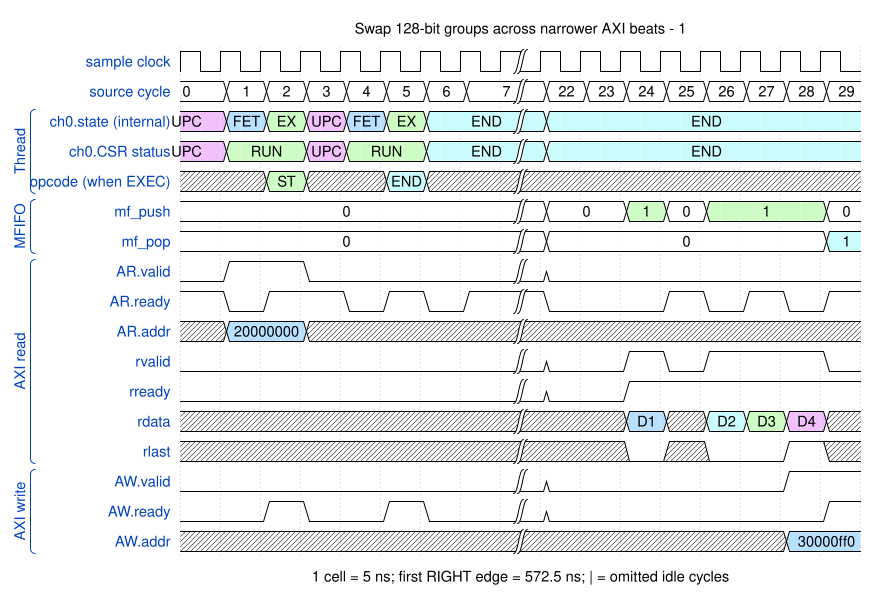
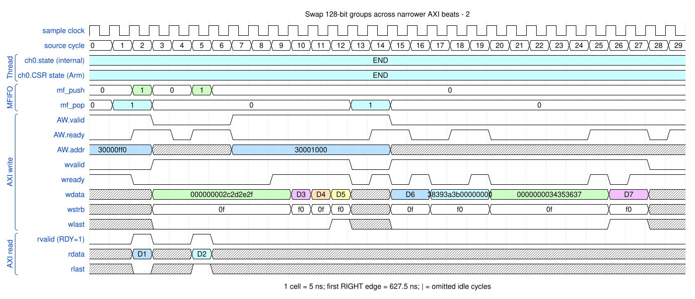

# Swap 128-bit groups across narrower AXI beats

<!-- reading-nav -->
[Guide index](README.md) · [Background](00_background.md) · [← Previous: 22. Drain an implicit barrier before changing the transfer stream](22_reconfiguration.md) · [Next: 24. Reject a forbidden non-secure CCR before committing it →](24_ccr_permissions.md)
<!-- /reading-nav -->

## Purpose

Follow 16-byte endian groups staged across a 64-bit read bus and narrower writes.

## Starting conditions

The directed probe initializes bytes 0x20 onward, transfers 32 bytes to destination 0x30000ff0, and applies 128-bit byte reversal with bus stalls.

## Minimal sequence

The sequence below is an explanatory sketch. The recorded assembler may emit extra CCR updates or loop setup. The source-run name below identifies the reproducible simulation.

```text
MOV CCR, swap128 ; MOV SAR, 0x20000000 ; MOV DAR, 0x30000ff0
LD ; ST ; END
```

## Read the waveform

1. Read beats contribute bytes to complete 16-byte groups; a group need not fit one 64-bit bus beat.
2. Output bytes reverse within each 16-byte group, not across the entire 32-byte descriptor.
3. Write context and WDATA remain associated through stalls and the 4 KB split. The independent probe checks every destination byte against 0x20 + (index XOR 15).

Group brackets separate the thread, shared storage and active interfaces. Inactive interfaces and uninformative constant rows are omitted. A constant needed to explain a stall or security decision stays visible. Pastel state colors distinguish execution, waiting and faults; equal payload values share a color across read/write rows. [WaveDrom conventions and color legend](00_conventions.md) define cell timing, data labels and snapshots.

### Waveform 1

[](../svg/23_swap128_1.svg)

[Open SVG at full size](../svg/23_swap128_1.svg) | [WaveDrom JSON](../wavejson/23_swap128_1.json)

Arm CSR labels: `EXEC` = Executing (`0x1`); `UPC` = Updating PC (`0x3`); `COMP` = Completing (`0x9`).

Source: `spec_wide_swap`. Core/unit cycle snapshots cover the selected **562.5..712.5 ns** interval. The first cell's right sampling edge is **562.5 ns**.

| Exact VCD time (ns) | Milestone | Meaning |
|---:|---|---|
| 572.5 | AR accepted | ID=0; address=0x20000000; 4 beats x 8 B; INCR |
| 637.5 | AW accepted | ID=0; address=0x30000ff0; 4 beats x 4 B; INCR |
| 652.5 | RLAST accepted | RESP=0 |
| 687.5 | WLAST accepted | WSTRB=0xf0 |
| 697.5 | AW accepted | ID=0; address=0x30001000; 4 beats x 4 B; INCR |

Full values for the short labels in this picture (matching D labels mean matching data):

| Label | Signal(s) | Full value |
|---|---|---|
| D1 | rdata | `2726252423222120` |
| D2 | rdata | `2f2e2d2c2b2a2928` |
| D3 | rdata | `3736353433323130` |
| D4 | rdata | `3f3e3d3c3b3a3938` |
| D5 | wdata | `28292a2b00000000` |
| D6 | wdata | `0000000024252627` |
| D7 | wdata | `2021222300000000` |
| D8 | wdata | `000000003c3d3e3f` |

Useful constant context: `AR.len=03`; `AW.len=03`.

### Waveform 2

[](../svg/23_swap128_2.svg)

[Open SVG at full size](../svg/23_swap128_2.svg) | [WaveDrom JSON](../wavejson/23_swap128_2.json)

Arm CSR labels: `COMP` = Completing (`0x9`).

Source: `spec_wide_swap`. Core/unit cycle snapshots cover the selected **627.5..777.5 ns** interval. The first cell's right sampling edge is **627.5 ns**.

| Exact VCD time (ns) | Milestone | Meaning |
|---:|---|---|
| 637.5 | AW accepted | ID=0; address=0x30000ff0; 4 beats x 4 B; INCR |
| 652.5 | RLAST accepted | RESP=0 |
| 687.5 | WLAST accepted | WSTRB=0xf0 |
| 697.5 | AW accepted | ID=0; address=0x30001000; 4 beats x 4 B; INCR |
| 762.5 | WLAST accepted | WSTRB=0xf0 |

Full values for the short labels in this picture (matching D labels mean matching data):

| Label | Signal(s) | Full value |
|---|---|---|
| D1 | rdata | `3736353433323130` |
| D2 | rdata | `3f3e3d3c3b3a3938` |
| D3 | wdata | `28292a2b00000000` |
| D4 | wdata | `0000000024252627` |
| D5 | wdata | `2021222300000000` |
| D6 | wdata | `000000003c3d3e3f` |
| D7 | wdata | `3031323300000000` |

Useful constant context: `AW.len=03`; `rready=1 (no back-pressure)`.

## Result and rule to remember

Endian group width can exceed bus width in this revision. Group staging, bus beat width and descriptor byte count are separate concepts.

## Design reference

TRM section 2.11.2; current write-engine endian group buffer.

For source tests, reproduction commands and validation scope, see [Reproduction and validation](99_validation.md).

---

<!-- reading-nav -->
[Guide index](README.md) · [Background](00_background.md) · [← Previous: 22. Drain an implicit barrier before changing the transfer stream](22_reconfiguration.md) · [Next: 24. Reject a forbidden non-secure CCR before committing it →](24_ccr_permissions.md)
<!-- /reading-nav -->
