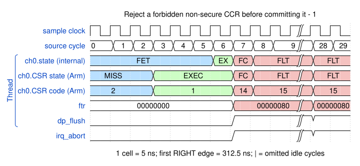

# Reject a forbidden non-secure CCR before committing it

<!-- reading-nav -->
[Guide index](README.md) · [Background](00_background.md) · [← Previous: 23. Swap 128-bit groups across narrower AXI beats](23_swap128.md) · [Next: validation →](99_validation.md)
<!-- /reading-nav -->

## Purpose

Show a precise security abort at DMAMOV CCR rather than a later data-access error.

## Starting conditions

Launch channel 0 non-secure and attempt MOV CCR, 0, which requests secure protection attributes.

## Minimal sequence

The sequence below is an explanatory sketch. The recorded assembler may emit extra CCR updates or loop setup. The source-run name below identifies the reproducible simulation.

```text
MOV CCR, 0 ; SEV E0 ; END
```

## Read the waveform

1. Permission checks examine both immediate protection fields before updating CCR.
2. The probe requires FTR=0x80 and CPC=0x10000, identifying the offending MOV.
3. The following SEV must not execute; the probe checks that E0 is not set. Fault cleanup proceeds to the latched fault state.

Group brackets separate the thread, shared storage and active interfaces. Inactive interfaces and uninformative constant rows are omitted. A constant needed to explain a stall or security decision stays visible. Pastel state colors distinguish execution, waiting and faults; equal payload values share a color across read/write rows. [WaveDrom conventions and color legend](00_conventions.md) define cell timing, data labels and snapshots.

### Waveform 1

[](../svg/24_ccr_permissions_1.svg)

[Open SVG at full size](../svg/24_ccr_permissions_1.svg) | [WaveDrom JSON](../wavejson/24_ccr_permissions_1.json)

Source: `spec_ccr_security`. Core/unit cycle snapshots cover the selected **312.5..462.5 ns** interval. The first cell's right sampling edge is **312.5 ns**.

| Exact VCD time (ns) | Milestone | Meaning |
|---:|---|---|
| 342.5 | FTR | 0x80 |

## Result and rule to remember

A precise programming-permission fault prevents subsequent instruction effects and preserves the prior CCR.

## Design reference

TRM Table 3-21 and channel security checks.

For source tests, reproduction commands and validation scope, see [Reproduction and validation](99_validation.md).

---

<!-- reading-nav -->
[Guide index](README.md) · [Background](00_background.md) · [← Previous: 23. Swap 128-bit groups across narrower AXI beats](23_swap128.md) · [Next: validation →](99_validation.md)
<!-- /reading-nav -->
